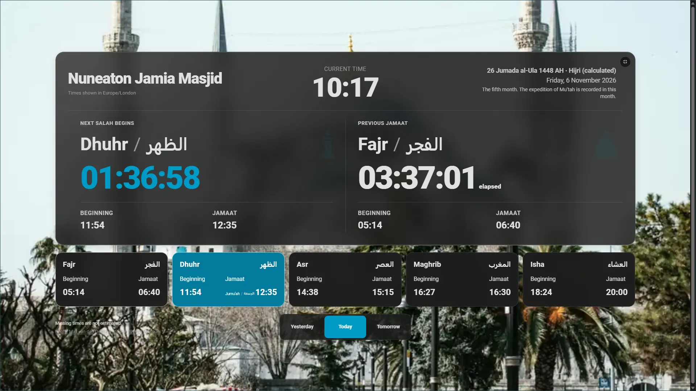
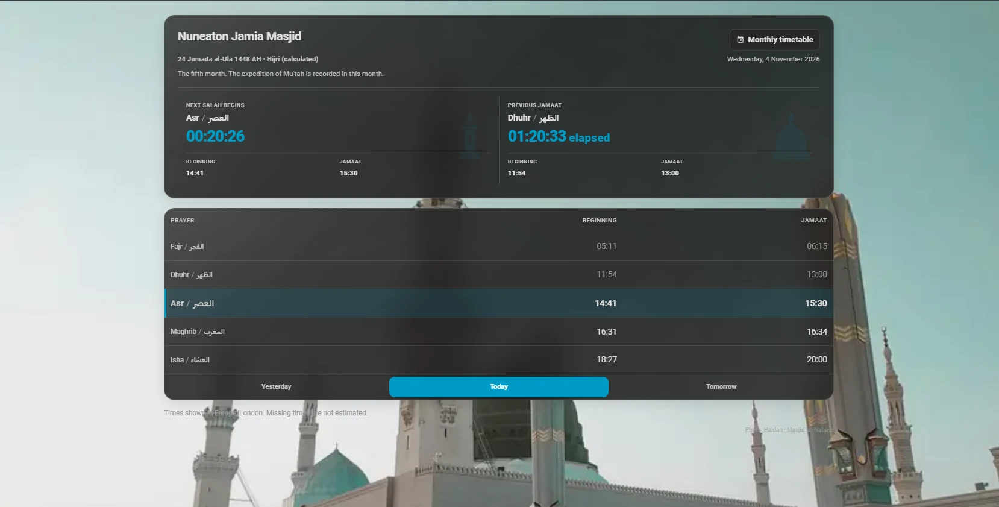

# Salah Timetable

[](https://github.com/anaschillin/home-assistant-salah-timetable/actions/workflows/validate.yml)
[](https://github.com/anaschillin/home-assistant-salah-timetable/actions/workflows/validate.yml)
[](https://github.com/anaschillin/home-assistant-salah-timetable/actions/workflows/validate.yml)
[](LICENSE)

Current integration version: **<!-- docs:version -->3.1.1<!-- /docs:version -->**.

A Home Assistant custom integration for importing **published mosque Salah and Jamaat timetables**. Configure one or more mosques, import a supported PDF/CSV or public HTTPS source, explicitly approve the timetable, and display it with a bundled Lovelace card.

## Features

- Separate mosque configurations, sensors, independent next-Salah and next-Jamaat countdowns, and a prayer calendar.
- Dedicated v3 kiosk / wall-display layout: live clock and mosque-local dates, spacious Salah/Jamaat countdowns, five published prayer tiles, and accessible day/fullscreen controls. The v3.1.1 candidate further enlarges Beginning/Jamaat values when a single kiosk countdown is displayed.
- Annual, monthly and Ramadan sources; automatic recognition of **supported** PDF layouts, source comparison and guided next-year URL imports with approval before activation.
- Guided readiness checks, optional publisher URL templates and manual CSV imports spanning two adjacent years.
- Compact, Standard and Detailed responsive cards with multi-mosque selection, Yesterday/Today/Tomorrow navigation, Gregorian/Hijri dates and optional mosque photography. In v3.1.0, hiding either countdown enlarges and centres the other with Beginning/Jamaat times beside it; when both are visible, headings, clocks and times align.
- Optional monthly timetable browsing, approved-year CSV export and redacted source details.
- Configurable prayer-completeness diagnostics, calculated night information and wall/tablet display mode.
- Candidate dashboard widgets for upcoming Jamaat changes and approved timetable health, with optional linked mosque selection. See [widget setup](docs/dashboard.md#jamaat-changes-and-timetable-health-widgets); these are not included in stable v3.1.1.
- Six optional blueprints for prayer reminders, media playback, date-coverage alerts and required-field completeness alerts.

**Important:** Values come from approved publications; this integration does not calculate authoritative prayer schedules or invent missing times. Only [documented PDF layouts](docs/import_review.md#supported-pdf-layouts) are supported.

## Dashboard preview

### Kiosk / wall display — v3.0



*Maintainer-approved kiosk screenshot (6 November 2026), showing the established v3 kiosk layout with both countdowns visible. The mosque photograph is decorative and separately licensed. v3.1.0 also supports an enlarged, centred single countdown when the other is hidden.*

### Standard and Detailed dashboard



*The non-kiosk Compact, Standard and Detailed layouts remain available independently of kiosk mode. The v3.1.0 countdown alignment and single-panel improvements apply to all these modes as well as kiosk.*

Explore [kiosk, desktop, mobile and tablet screenshots](docs/dashboard.md#device-screenshots), including Compact's **More** menu, the monthly timetable and the redesigned card editor. For configuration, see [Dashboard getting started](docs/getting-started.md#add-the-dashboard-card) and the [Dashboard guide](docs/dashboard.md).

## Install

Home Assistant **<!-- docs:homeassistant_min -->2026.10.0<!-- /docs:homeassistant_min --> or newer** is required.

[](https://my.home-assistant.io/redirect/hacs_repository/?owner=anaschillin&repository=home-assistant-salah-timetable&category=integration)

<!-- docs:excerpt installation -->
Use Home Assistant OS or Home Assistant Container on Linux; these supply the process limits required for PDF extraction. The tested versions are listed in the [compatibility guide](docs/testing.md#compatibility-test-environments).

### HACS catalogue (recommended)

Salah Timetable is officially listed in the [default HACS catalogue](https://github.com/hacs/default/blob/master/integration). On Home Assistant 2026.10, [install and configure HACS](https://www.hacs.xyz/docs/use/) first. On Home Assistant 2026.11 and newer, HACS is built in as [Marketplace](https://www.hacs.xyz/docs/marketplace/).

1. Open **HACS** on Home Assistant 2026.10, or **Settings → Marketplace** on 2026.11 and newer, and search for **Salah Timetable**.
2. Open its catalogue entry, select **Download** in HACS or **Install** in Marketplace, confirm the latest stable version and restart Home Assistant.
3. Open **Settings → Devices & services → Add integration → Salah Timetable**.
4. Enter the mosque name, a stable mosque ID and its IANA timezone (for example, `Europe/London`). Use a different ID to add another mosque.

### HACS custom repository (fallback)

If you cannot find the catalogue entry, add the repository manually in HACS:

1. In HACS, open the top-right **⋮ → Custom repositories** menu.
2. Add `https://github.com/anaschillin/home-assistant-salah-timetable`, select type **Integration** and choose **Add**.
3. Follow steps 2–4 of the HACS catalogue procedure above to download, restart and configure the integration.

In Marketplace, use **Add from link** with the same repository URL and choose **Add**, connecting GitHub if prompted. If it is already listed, use its catalogue entry, then follow steps 2–4 of the HACS catalogue procedure above.

### Manual installation

Download the desired [stable release](https://github.com/anaschillin/home-assistant-salah-timetable/releases), extract it, and copy the complete `custom_components/salah_timetable` directory into Home Assistant's configuration directory as `config/custom_components/salah_timetable/`. The `manifest.json` must be directly inside that directory, with its `frontend/`, `translations/` and other bundled files alongside it. Restart Home Assistant, then follow steps 3–4 of the HACS catalogue procedure above.
<!-- /docs:excerpt installation -->

After installation, follow [Getting started](docs/getting-started.md) to import and approve a timetable and add the dashboard card.

## Documentation

| Guide | Contents |
| --- | --- |
| [Getting started](docs/getting-started.md) | Setup, imports, reconfiguration, removal and troubleshooting |
| [Dashboard](docs/dashboard.md) | Card options and multiple mosques |
| [Importing and validation](docs/import_review.md) | Configuration fields/defaults, PDF layouts, approval, Ramadan and source updates |
| [Automations and entities](docs/automations.md) | Entity reference/defaults, prayer calendar, blueprints and coverage alerts |
| [Architecture](docs/architecture.md) | Internal design for contributors |
| [Testing](docs/testing.md) | Tests, coverage and development |
| [Releasing](docs/releasing.md) | Release workflow, sign-off and internal Quality Scale rule audit |
| [Roadmap](docs/roadmap.md) | Future plans only |
| [Assets and credits](docs/asset-provenance.md) | Source checks, image licensing and fixture provenance |
| [Islamic history research](research/islamic-history/islamic-history-source-audit.md) | Research proposals, not released features |

## Support and compatibility

<!-- docs:excerpt support-summary -->
Salah Timetable is a community-maintained, MIT-licensed integration without guaranteed response times or a paid support service. Compatibility is limited to the [pinned Home Assistant environments](docs/testing.md#compatibility-test-environments) and [documented timetable layouts](docs/import_review.md#supported-pdf-layouts).
<!-- /docs:excerpt support-summary -->

For safe bug reports and support requests, see the [support policy](docs/getting-started.md#support-and-compatibility-policy). Report vulnerabilities privately as described in [Security](SECURITY.md).

## Development

From a repository checkout, use Python <!-- docs:python_min -->3.14.2<!-- /docs:python_min -->+
in the [supported Python series](docs/testing.md#compatibility-test-environments), Node.js <!-- docs:node_major -->24<!-- /docs:node_major -->
and uv <!-- docs:uv -->0.13.6<!-- /docs:uv -->. Run the full suite on Linux/WSL.
Install Chromium/Chrome for the browser check; set `CHROME_BIN` if it is not found
automatically. Frontend tests have no npm dependencies and need no `npm install`.
See [Contributing](CONTRIBUTING.md) for environment setup and WSL guidance.
Run these commands from the repository root:

<!-- docs:excerpt development-checks -->
```sh
uv sync --frozen --group dev
uv run --frozen pytest
uv run --frozen ruff check .
uv run --frozen ruff format --check .
npm test
REQUIRE_BROWSER_TESTS=1 npm run test:browser
```
<!-- /docs:excerpt development-checks -->

GitHub Actions additionally performs HACS/hassfest and disposable Home Assistant checks.

<!-- docs:excerpt validation-boundaries -->
HACS repository validation does not prove installation through the authenticated HACS UI. Chromium tests use Home Assistant element stand-ins, and disposable Home Assistant Container checks do not establish physical-device behaviour or full Home Assistant OS/Supervisor restoration. Assess the **exact candidate version** through the manual [release acceptance checklist](docs/releasing.md#manual-hacs-and-home-assistant-acceptance).
<!-- /docs:excerpt validation-boundaries -->

See [Contributing](CONTRIBUTING.md), [Testing](docs/testing.md) and [Release guidance](docs/releasing.md).
