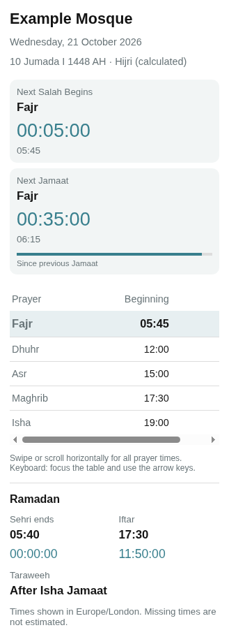

# Dashboard card

The **Salah Timetable** card is bundled with the integration. It uses the mosque's
**Prayer timetable** sensor and requires no separate card download, Card Mod,
template sensors or YAML configuration.

## Preview

These candidate 0.6.1 screenshots show synthetic data in the isolated Chromium
fixture with Home Assistant control stand-ins. They cover phone/tablet card layout;
they are not screenshots of a HACS installation or physical-device certification.
Real Home Assistant runtime/editor acceptance is recorded separately in
[validation](validation.md).



[Tablet-width screenshot](images/card-tablet-0.6.1.png)

The older [0.5.1 phone](images/card-mobile.png) and
[tablet](images/card-tablet.png) screenshots are retained as historical references.

## Add the card

1. Install the integration, configure a mosque and approve a timetable.
2. Choose **Edit dashboard → Add card → Salah Timetable**.
3. Choose a **Prayer timetable** sensor in the graphical editor.
4. Select **Card detail**: **Compact**, **Standard** (default) or **Detailed**.
   Set optional title, language, time format and visibility preferences, then save.

When two or more mosque timetable sensors are available, the editor shows
**Mosques available on this card** checkboxes. By default all mosques are enabled
for backwards compatibility. Uncheck mosques to exclude them from this card;
at least one mosque must remain enabled. The primary **Prayer timetable** selection
controls which mosque appears first, and is kept within the enabled set.

When multiple mosques are enabled, a native selector in the header replaces
the duplicated mosque name and wide tab strip. With one enabled mosque, the
header displays a plain title. An optional custom title replaces the primary
mosque's selector label. Switching mosques resets day navigation to Today without
changing Home Assistant entity states. Each card has independent selections:
add multiple cards to one dashboard, restrict each to one mosque, or use separate
dashboards. Existing cards without `mosque_entities` continue to show all
discovered mosques, including newly added ones.

## Day navigation

The **Yesterday / Today / Tomorrow** controls sit in a slim footer inside the
timetable frame, rather than above the prayer summaries. Today is selected initially.
The header's Gregorian **and calculated Hijri dates**, plus the contextual Hijri
month description, update with the selected day. The timetable does not repeat
the Gregorian date when it is already in the header; a date label remains if
the Gregorian header is disabled or the card is in Compact mode.
All three views share the same table styling, labels, time formatting and responsive
layout. Yesterday and Tomorrow hide **both** prayer summary cards, live countdowns,
current-prayer highlighting, and today's Ramadan/status sections. They show only
the selected day's actual approved beginning and Jamaat timetable. This also
applies when Compact is selected: its adjacent-day views show the full table.
On a date with no approved times, the footer stays visible beneath an unavailable
message so users can return to Today.

The backend supplies independent published rows for the three local dates using
its already-resolved effective timetables. Missing approved rows display
**No approved timetable is available for this date** rather than copying today's
times. Date selection does not modify Home Assistant sensor state or stored data.

## Card detail levels

| Level | Today's display |
| --- | --- |
| Compact | Next Salah countdown with beginning and Jamaat, plus context-aware upcoming/previous Jamaat; active Ramadan details when enabled |
| Standard (default) | Both matching prayer cards, full timetable, Hijri date (if enabled), and active Ramadan details |
| Detailed | Standard plus published Fajr sunrise/end and second Friday khutbah (if present) |

**Next Salah** always means the next *beginning* time, even if the current
prayer's Jamaat is still upcoming. The countdown and published times from that
event's actual date appear together. **Next Jamaat** counts down while the
current prayer's congregation is still approaching; at its exact instant the
same panel becomes **Previous Jamaat** and shows elapsed time.
The mosque title, Hijri date/description, Gregorian date and both countdown
sections now live inside **one consistently frosted-glass summary card**,
with stronger background opacity and blur to keep prayer information legible over
the mosque photograph. Both halves have **identical transparent surfaces,
padding, label typography, countdown sizing and time-grid formatting**; only
a fine separator distinguishes them, rather than different background tints
or independent borders. Each countdown still has its own published
beginning/Jamaat values, label and live timer. A faint **minaret silhouette** decorates Next Salah and a faint
**dome silhouette** decorates the contextual Next/Previous Jamaat countdown.
Both are inline local SVG with `aria-hidden`, carry no data and do not
represent the selected mosque. The two summaries sit side by side on most
phones/tablets, stack on very narrow cards, and collapse independently through
the card's existing visibility options. On Yesterday/Tomorrow, the shared
surface retains the mosque/date heading but hides the live countdowns.
The old context/upcoming/previous Jamaat panel selector has been removed.

Fajr end is the *published sunrise*, never a calculated estimate. Published
Jumu’ah congregations remain in Dhuhr's Jamaat row, and the separately published
second khutbah (if any) is not treated as a Jamaat. Missing times are displayed
as unavailable rather than inferred. Ramadan details are shown in all three display levels when Ramadan is active and the card's Ramadan details option is enabled.

## Timing and boundaries

Next Salah and the contextual Next/Previous Jamaat are selected independently from the published
absolute event timeline. After Isha, the next Salah uses tomorrow's actual Fajr
record; missing tomorrow data yields an unavailable countdown. Its time grid also
uses tomorrow's actual published Fajr, Jamaat and sunrise, never today's row. At a prayer
beginning boundary, the next Salah advances to the next published beginning.
Events are drawn from yesterday, today and tomorrow, including leap-year and
year-end transitions. The card updates the live countdown in the browser without
per-second Home Assistant state writes.

Today's full timetable highlights the relevant prayer and dims completed rows;
Yesterday and Tomorrow have no current-prayer highlighting. Tables retain semantic
headers, LTR-isolated numeric times, a keyboard-focusable scroll region, and
responsive handling for narrow screens.

## Language and direction

The card editor offers **Automatic (Home Assistant)**, **English** and
**العربية**. Automatic uses Arabic labels and right-to-left layout for an Arabic
Home Assistant interface, with English label fallback for other interface
languages. Supported Home Assistant regional locales are retained for date and
number formatting; choosing an explicit card language uses a matching regional
locale when available.

Enable **Bilingual prayer labels** to show both English and Arabic names, with
the selected language first. Each name carries its own language and direction;
clock values remain isolated in left-to-right order in both layouts. This applies
to known prayer names in the timetable and event panels. Custom mosque titles
remain user-supplied text. Language changes affect presentation only: prayer
keys, entity IDs, stored values and event identities stay unchanged.

This is Milestone **10A**, covering the bundled card and editor. Arabic wording
is a draft awaiting fluent-language review. Integration settings/forms, entity
translations and translated setup guidance remain Milestone **10B** work.
Automated browser checks and physical-device acceptance are recorded separately;
older device confirmations do not establish Arabic/RTL acceptance.

## Dates and customization

The **primary Hijri header** uses the browser's **Umm al-Qura** calendar to
convert the mosque's Gregorian timetable date, displaying its Islamic day,
**named Hijri month** and year. The Gregorian date is a separate secondary
line; hide it via the card's `show_gregorian_date: false` switch without
hiding Hijri. Both default to visible for existing cards.
It advances at mosque-local midnight, not sunset. The default is visible; choose
**Show full calculated Hijri date on dashboards** during initial mosque setup,
or change it later via **Configure → Mosque settings**. Older mosque entries
without a stored preference default to visible. The card editor's
`show_hijri_date` option is an additional per-card hide switch: the header is
visible only if **both** the mosque and that card permit it.
The optional −3 to +3 day adjustment changes only the displayed Hijri date. It does
not shift imported records, prayer events, Ramadan confirmation or Ramadan's separate
date adjustment. The date is labelled calculated; unsupported browsers show
**Hijri date unavailable** rather than silently substituting another calendar.

The following *card-specific* options are available in the graphical editor.
The mosque-wide Hijri preference is managed separately in the integration settings:

| YAML option | Values and default |
| --- | --- |
| `entity` | The initial/primary `sensor.*_prayer_timetable` entity on the card |
| `mosque_entities` | Optional list of enabled Prayer timetable sensor IDs; omit to show all configured mosques (legacy behaviour); requires at least one when set |
| `language` | `auto` (default), `en`, `ar`; automatic follows the HA interface language with English label fallback |
| `bilingual_prayer_labels` | `false` (default); show English and Arabic known prayer names |
| `detail_level` | `standard` (default), `compact`, `detailed` |
| `layout` | Legacy `compact` maps to Compact; `expanded` maps to Standard if no `detail_level` is saved |
| `mode` | Legacy setting ignored; no longer exposed in the editor |
| `time_format` | `24h` (default), `12h`; applies to every absolute time |
| `show_salah_countdown` | `true` |
| `show_jamaat_countdown` | `true` |
| `show_hijri_date` | `true`; further hides the mosque-enabled full Hijri date on this card |
| `show_gregorian_date` | `true`; independently displays the secondary Gregorian date |
| `show_hijri_month_info` | `true`; shows a short, non-repeating description directly beneath the visible Hijri date in the header; hidden when the Hijri date is hidden |
| `hijri_adjustment` | Whole days −3 through +3; default `0` |
| `show_ramadan_details` | `true`; controls the entire Ramadan section |
| `show_sehri_countdown` | `true`; hiding retains the displayed absolute time |
| `show_iftar_countdown` | `true`; hiding retains the displayed absolute time |
| `show_timezone_note` | `true`; controls the timezone and missing-time note |\n| `show_mosque_background` | `true`; display a subtle bundled mosque photograph; `false` disables the image |\n| `mosque_background` | `daily` (default); `none`, or a bundled mosque ID for a fixed photo |\n| `mosque_background_opacity` | Whole number from `0` to `20`; default `7` (%) |

Hiding either main panel removes it; the remaining panel fills the width.
Hiding both leaves the header and timetable. Connection warnings and narrow-card
scrolling guidance remain available when the timezone note is hidden. Taraweeh
belongs to the Ramadan details section. Countdown durations use hours/minutes/seconds
with a day prefix when needed, independent of 12/24-hour time format.
The legacy `mode` option is accepted but ignored for all cards. The Jamaat panel automatically
switches between the upcoming congregation and the previous one.

The four **coming soon** Islamic-history settings for day events, monthly
highlights, visible sources and disputed dates are disabled in the editor until
those features are implemented. Previously saved values remain inert. The Hijri
month description is implemented separately and can be hidden with
`show_hijri_month_info: false`. The description appears only as smaller text
beneath the full Hijri date, without a duplicate heading, separate panel or
footer disclosure. It follows the mosque's current header date when browsing
yesterday or tomorrow, and hides when the Hijri date is hidden.

## Optional mosque photograph backgrounds

The card bundles 20 WebP photographs from free Unsplash photo pages. They
are served from the integration itself, without remote requests or an Unsplash
account. Photo backgrounds rotate once per mosque-local published date by
default and do not repeat until all 20 have appeared. Choose a fixed mosque
from **Mosque background** in the card editor, set **Background opacity (%)**
(0–20), or switch off **Show mosque background** entirely.

The mosque photograph now covers the **full width of the canvas allotted
to this card** by Home Assistant, without a hard 1280px limit. Its image layer
retains the full Today-height composition while switching to shorter Yesterday
or Tomorrow views, so hiding the countdowns **does not re-zoom or re-centre
the photo**. The card itself still shrinks to its contents without an empty
reserved space. The captured image width and height stay fixed across
small Home Assistant canvas changes, including scrollbars appearing or
disappearing when countdowns are hidden. The cache is discarded for substantial
width changes (such as tablet rotation or a dashboard column resize). The timetable,
header and countdowns remain in an independently centred content column
(up to 1160px wide). On narrow cards and mobile screens, the content naturally
fills the available width. This creates wider photographic wings on landscape
tablets and desktops without stretching the prayer table excessively.

A softly blurred photographic rim and subtle translucent glass overlay
evoke the mockup without blurring text or prayer times. The full-width outer
card has **no drop shadow**, avoiding a dark halo around the photograph; the
inner frosted summary retains its own restrained depth.
The Hijri date, Gregorian date and month explanation occupy separate header
rows on mobile, tablet and desktop. Background opacity still controls the
photo's visibility. Increased-contrast and reduced-transparency preferences
hide the image and disable glass effects.

Home Assistant determines each card's **parent column width**, and the card
cannot paint outside that column or across a sidebar. To fill a wider dashboard
canvas, place the card in a full-width section or panel view. Photographer
credit stays with the centred content and links to the original photo. See
[image credits and source links](mosque-background-credits.md).

These decorative backgrounds do not represent the currently configured mosque
and cannot influence prayers, mosque identity, calculations or data imports.

## Ramadan controls

Use the mosque integration's **Configure → Ramadan settings**; the card reflects
these settings automatically.

**Automatic** needs both confirmed Gregorian start/end dates, inclusive, spanning
1–35 days. With no confirmed range it is inactive. **Manual on** explicitly activates
Ramadan until changed and ignores the date window; **Off** disables it. The whole-day
-3 to +3 adjustment shifts the confirmation window only. It never shifts source rows.
Clear both date fields to remove an old confirmation.

During active dates, a matching Ramadan row overrides the same annual date field by
field. Choose an explicit source if multiple Ramadan tables overlap; automatic
selection requires a unique match. An import's dates or printed Hijri dates alone
never confirm Ramadan. Missing override fields retain annual values; missing dates
never borrow another day's row.

A separately published Iftar time takes priority. Otherwise Iftar uses effective
Maghrib beginning if present. Missing published Taraweeh shows **After Isha Jamaat**;
the integration does not create a separate Taraweeh timestamp. Sehri/Iftar countdowns
use active Ramadan dates only. Original imported values remain unchanged.

## Resource troubleshooting

The integration serves versioned assets and automatically registers the card in
storage-mode Lovelace resources. With YAML-managed resources it uses HA's supported
extra-JavaScript registration without editing your YAML. A second manual resource
is normally unnecessary.

If the card remains unavailable after restarting the integration and reloading the
browser, check Home Assistant logs for resource-registration errors. As a fallback,
add this **JavaScript module** resource through **Settings → Dashboards → Resources**
(enable Advanced Mode in your HA profile if the Resources option is hidden):

```text
/salah_timetable/salah-timetable-card.js?v=0.9.13
```

Reload the page after saving. Check for obsolete or duplicate manual resources if an
old card version persists. The integration updates its own registration on upgrades;
manual fallback URLs may need their version changed to the installed version.

If the card reports a missing entity, choose the mosque's Prayer timetable sensor
again. If prayer values are unavailable, check the approved source's date coverage,
field mappings and mosque timezone. An empty mosque has no prayer times until an
import is approved. A connection warning means the card is displaying the last data
received; restore the HA connection before relying on it for changed timetable data.

For reference, the card's optional YAML representation is:

```yaml
type: custom:salah-timetable-card
entity: sensor.example_mosque_prayer_timetable
language: auto
bilingual_prayer_labels: false
layout: expanded
time_format: 24h
show_hijri_date: true
show_gregorian_date: true
hijri_adjustment: 0
```

The graphical editor produces this configuration. The legacy `mode` property
is ignored if present; `title` is optional. The example entity ID must be replaced
with the selected mosque's actual entity ID.

## Validation limits

Backend event/flow tests, Node frontend tests and an isolated headless Chromium
harness cover the implemented behavior, including every visibility switch off and
on independently. That harness uses stand-ins for HA elements. Separate disposable
manual-install checks used HA 2026.10.2 and HA 2026.10.0; the latter exercised the
actual card picker, editor controls, keyboard title/focus, saved configuration after
page reload, themes and phone/tablet viewports for candidate 0.6.1. These checks used
an explicitly preloaded PDF dependency. The later local 0.6.2 HA 2026.10.0 run
passed 20 checks, including fresh dependency installation without a package preload,
per-toggle visible previews and saved settings after reload. Physical-device checks
were user-confirmed on 24 October 2026, before 0.7.0; device/version details were
not recorded. That confirmation does not establish physical acceptance of the newer
Fajr-end, Friday-khutbah, Hijri setup/options controls or Arabic/RTL presentation.
HACS installation, restart and updates are also user-confirmed. Removal/reinstall
was user-confirmed on 25 October, with environment and individual cleanup checks
unrecorded; the full [HACS UI acceptance gate](hacs-removal-acceptance.md) remains
release work. The pushed 0.6.2 commit passed its hosted
checks; later release commits require their own checks. See the [validation record](validation.md) and
[Milestone 6](milestones.md#milestone-6--release-hardening-partially-implemented).
