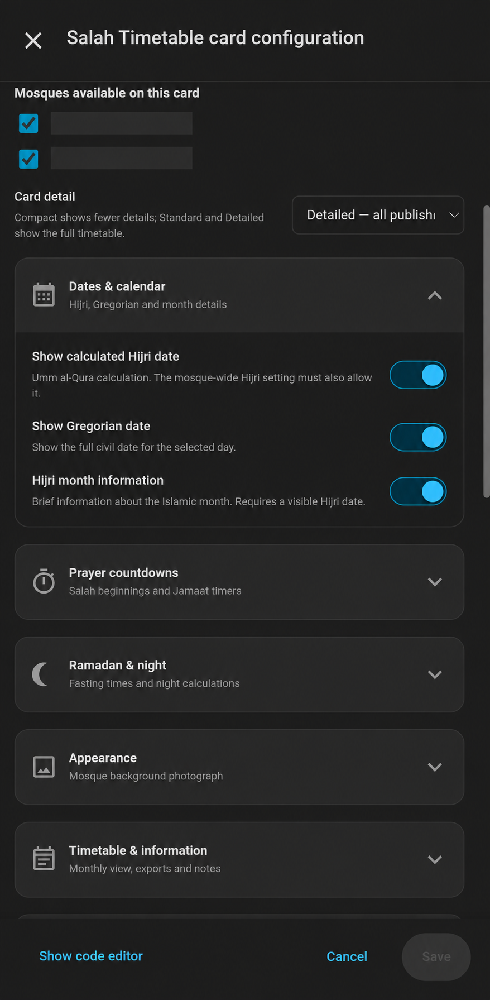
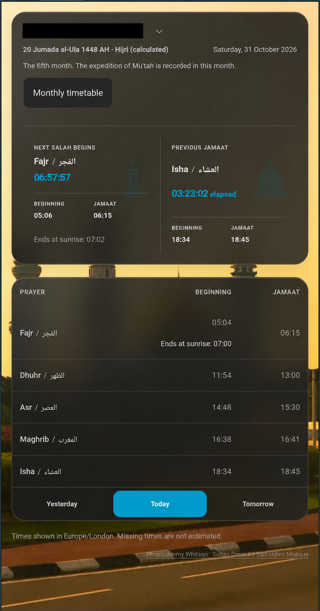
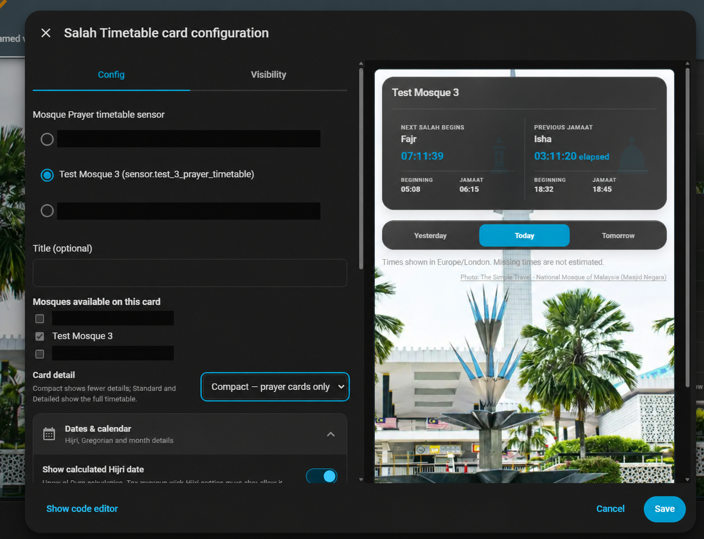

# Dashboard card

Current integration version: <!-- docs:version -->1.0.0<!-- /docs:version -->.

The **Salah Timetable** card is bundled with the integration. It uses the mosque's
**Prayer timetable** sensor and requires no separate card download, Card Mod,
template sensors or YAML configuration.

## Current layout

The card shows approved prayer times for today, yesterday and tomorrow. A header
selector switches between enabled mosques. See the [dashboard preview](../README.md#dashboard-preview)
and [editor and timetable examples](getting-started.md#add-the-dashboard-card).
Screenshots show example configurations, not authoritative prayer times.

## Add the card

1. Install the integration, configure a mosque and approve a timetable.
2. Choose **Edit dashboard → Add card → Salah Timetable**.
3. In **Mosques available on this card**, tick the mosque timetable sensors to display.
   All discovered mosques remain enabled for existing cards until you save a selection.
   At least one mosque must remain selected.
4. Drag a selected mosque by its six-dot handle or use the up/down arrow buttons
   to set the order. The first selected mosque is marked **Shown first** and is
   the default when the card loads. Unselected mosques remain visible but cannot
   be reordered until selected.
5. Select **Card detail**: **Compact**, **Standard** (default) or **Detailed**.
   Set the language, time format and visibility preferences,
   then save.

The editor has one ordered checkbox list, not a separate primary-sensor radio
selector. Existing cards without `mosque_entities` still show all discovered
mosques for backwards compatibility. Reordering or changing a checkbox saves an
ordered `mosque_entities` list and updates the default `entity` to its first entry.

With multiple mosques enabled, use the header selector to switch between them;
switching resets day navigation to Today. With one mosque, the header displays
a plain title. To customise it, set `title` in the YAML editor. It also overrides
the primary mosque's label when using the selector. The graphical editor preserves
an existing title when saving other settings. Each card has independent selections,
so separate cards or dashboards can show different mosques. Existing cards without `mosque_entities` show all
discovered mosques, including newly added ones.

## Graphical editor: grouped settings

The card editor places the ordered mosque checkboxes and
**Card detail** selector at the top. Seven collapsible sections organise the
remaining options: **Dates & calendar**, **Prayer countdowns**,
**Ramadan & night**, **Appearance**, **Timetable & information**,
**Islamic history**, and **Advanced settings**. Only one section expands at
a time; Dates & calendar is open initially. Switches control features,
checkboxes select mosques, and dropdowns choose values such as language,
detail level and mosque photograph. Each setting has contextual help.

| Section | Settings |
| --- | --- |
| **Dates & calendar** | Calculated Hijri date, Gregorian date and Hijri month information |
| **Prayer countdowns** | Salah beginning and Jamaat countdowns |
| **Ramadan & night** | Ramadan details, Sehri and Iftar countdowns, and calculated night information |
| **Appearance** | Mosque background photograph |
| **Timetable & information** | Monthly timetable, CSV export and source details; timezone and help text |
| **Islamic history** | Day events, monthly highlights, sources and disputed dates (all currently disabled) |
| **Advanced settings** | Language, bilingual labels, kiosk mode, time format, Hijri adjustment and day boundary |

See the [options and defaults](#dates-and-customization) below for the corresponding
YAML names and default values.

The following dependencies affect **whether a switch can be edited**, not its
saved configuration:

- **Hijri month information** requires **Calculated Hijri date** on this card.
  The mosque-wide Hijri preference can still independently hide both.
- **Sehri countdown** and **Iftar countdown** require **Ramadan details**.
  Actual Ramadan content is shown only with approved active Ramadan data.
- **Night midpoint & final third** requires Standard or Detailed card detail.
- Four **Islamic history** switches and their explanatory hints remain visible
  but disabled until the historical dataset and display features are implemented.

Disabled dependent switches retain their previously saved values; restoring
the parent switch or display mode restores the user's choices. Even when a
switch is enabled, a setting can be visually inapplicable to Yesterday/Tomorrow,
Compact mode, missing timetable data or a non-Ramadan date.

Under **Appearance → Mosque background**, choose **Off — no background**,
**Rotate daily**, or a fixed photograph. Turning the background off preserves
the saved photograph choice. See [background options](#optional-mosque-photograph-backgrounds).

### Mobile card setup



Select and order the mosques available on the card, choose its detail level,
then expand the relevant settings group. The six-dot drag grip is for pointer
reordering; the up/down buttons work with touch and keyboard. The mobile editor
scrolls; lower groups may be below the visible area. The screenshot above is
from the previous editor revision and will be replaced after HA acceptance.



Example approved timetable values are shown for illustration. Mosque identities
are obscured; the background photograph is decorative.

## Day navigation

The **Yesterday / Today / Tomorrow** controls sit in the timetable footer.
Today is selected initially.
The header's Gregorian **and calculated Hijri dates**, plus the contextual
Hijri month description, update with the selected day whenever those fields
are visible (Standard/Detailed; Compact hides those dates). The timetable does not repeat
the Gregorian date when it is already in the header; a date label remains if
the Gregorian header is disabled or the card is in Compact mode.
All three views share the same table styling, labels, time formatting and responsive
layout. Yesterday and Tomorrow hide **both** prayer summary cards, live countdowns,
current-prayer highlighting, and today's Ramadan/status sections. They show only
the selected day's actual approved beginning and Jamaat timetable. This also
applies when Compact is selected: its adjacent-day views show the full table.
On a date with no approved times, the footer stays visible beneath an unavailable
message so users can return to Today.

Missing approved rows display **No approved timetable is available for this date**
rather than copying today's times. Date selection does not modify stored data or
Home Assistant sensor state.

## Card detail levels

| Level | Today's display |
| --- | --- |
| Compact | Next Salah countdown with beginning and Jamaat, plus context-aware upcoming/previous Jamaat; active Ramadan details when enabled |
| Standard (default) | Both matching prayer cards, full timetable, Hijri date (if enabled), and active Ramadan details |
| Detailed | Standard plus published Fajr sunrise/end and second Friday khutbah (if present) |



**Next Salah** always means the next *beginning* time, even if the current
prayer's Jamaat is still upcoming. The countdown and published times from that
event's actual date appear together. **Next Jamaat** counts down while the
current prayer's congregation is still approaching; at its exact instant the
same panel becomes **Previous Jamaat** and shows elapsed time.
The summary panels sit side by side on most phones and tablets, stack on very
narrow cards, and can be hidden independently. On Yesterday and Tomorrow the
header remains while live countdowns are hidden. Decorative silhouettes do not
identify the selected mosque or carry timetable data.

Fajr end is the *published sunrise*, never a calculated estimate. Published
Jumu’ah congregations remain in Dhuhr's Jamaat row, and the separately published
second khutbah (if any) is not treated as a Jamaat. Missing times are displayed
as unavailable rather than inferred. Ramadan details are shown in all three display levels when Ramadan is active and the card's Ramadan details option is enabled.

## Timing and boundaries

Next Salah and the contextual Next/Previous Jamaat are selected independently from the published
absolute event timeline. After Isha, the next Salah uses tomorrow's actual Fajr
record; missing tomorrow data yields an unavailable countdown. Its time grid also
uses tomorrow's actual published Fajr, Jamaat and sunrise, never today's row. At a prayer
beginning boundary, the next Salah advances to the next published beginning.
Events are drawn from yesterday, today and tomorrow, including leap-year and
year-end transitions. The card updates the live countdown in the browser without
per-second Home Assistant state writes.

Today's full timetable highlights the relevant prayer and dims completed rows;
Yesterday and Tomorrow have no current-prayer highlighting. Tables retain semantic
headers, LTR-isolated numeric times, a keyboard-focusable scroll region, and
responsive handling for narrow screens.

## Language and direction

The card editor offers **Automatic (Home Assistant)**, **English** and
**العربية**. Automatic uses Arabic labels and right-to-left layout for an Arabic
Home Assistant interface, with English label fallback for other interface
languages. Supported Home Assistant regional locales are retained for date and
number formatting; choosing an explicit card language uses a matching regional
locale when available.

Enable **Bilingual prayer labels** to show both English and Arabic names, with
the selected language first. Each name carries its own language and direction;
clock values remain isolated in left-to-right order in both layouts. This applies
to known prayer names in the timetable and event panels. Custom mosque titles
remain user-supplied text. Language changes affect presentation only: prayer
keys, entity IDs, stored values and event identities stay unchanged.

The bundled card/editor supports the described language and direction options.
Additional integration translations and reviewed Arabic wording are deferred.
Automated browser checks do not establish full Arabic/RTL acceptance on physical devices.

## Monthly timetable and CSV/source information

Enable **Monthly timetable, CSV export and source details** in the card editor
(`show_month_view: true`). In **Standard** and **Detailed**, the labelled
**Monthly timetable** button sits right-aligned on the same row as the mosque
name, above the Gregorian date. Its calendar icon and label share the same text
size. On narrow cards, the label hides to keep the title readable; the button's
accessible name and tooltip remain available. In **Compact**, open **More** in
the header and select **Monthly timetable**. Its dropdown floats over the card
rather than moving the countdown panels or timetable.

While browsing a month, **Return to daily timetable**, **Export year CSV**,
**Source details**, and **Refresh** appear in the same location:
Compact's More menu or the Standard/Detailed header action strip.
The calendar opens a Gregorian month browser. Previous/next month and Refresh
retrieve at most 31 days of **approved effective** times for the selected mosque; missing
dates and prayer fields display as missing, never calculated or filled.
Ramadan overrides apply only when explicitly active for those dates.
The card's original Yesterday/Today/Tomorrow and live countdowns are unchanged.

**Export year CSV** downloads a standard UTF-8 CSV for the currently viewed
Gregorian year, including the mosque's timezone, all canonical published
fields and multi-time Jumu’ah values. It contains blank cells for missing
fields/dates, and exports effective approved rows only (not source documents).
**Source details** shows a redacted approved-source summary: date coverage,
format, number of rows and check status, without original PDF, raw URL,
credential-like source contents or pending-import data.

These features use authenticated Home Assistant WebSocket requests, checking
the viewer's permission to read the selected mosque's dashboard entity. This
does not introduce a public download endpoint. Depending on the Android
WebView, the browser download prompt may vary.

## Calculated night information

Enable **Show calculated night midpoint and final third** in the card editor
(`show_night_calculations: true`) to show derived values in the Standard or
Detailed **Today** view. The interval runs from today's approved Maghrib
beginning to the following day's approved Fajr beginning. The midpoint is
halfway through that elapsed interval; the final third starts two-thirds of
the way through it. Elapsed UTC time preserves the calculation across DST
changes, and the card displays the result in the mosque's timezone.

Both approved anchors must exist and form a valid night interval. Missing
anchors leave this section unavailable; no sunset or Fajr time is inferred.
These values are labelled calculated and do not replace published prayer
times, create sensors/calendar events or change Ramadan activation.

## Wall and tablet display

Enable **Kiosk / wall display mode** in the card editor (`kiosk_mode: true`)
for larger responsive presentation. The card keeps its existing mosque/day
controls and timetable data. Place it in a full-width dashboard view when
using a dedicated display.

The fullscreen button requires a tap or click and browser support. If the
browser or WebView rejects fullscreen, the larger card presentation remains
usable. This option does not lock the device, manage screen sleep, provide
announcements or change Home Assistant's dashboard/navigation settings.

## Dates and customization

In Standard/Detailed mode, the **primary Hijri header** uses the browser's **Umm al-Qura** calendar to
convert the mosque's Gregorian timetable date, displaying its Islamic day,
**named Hijri month** and year. The Gregorian date is a separate secondary
header field; hide it via the card's `show_gregorian_date: false` switch without
hiding Hijri. Both default to visible for existing cards.
By default it advances at mosque-local midnight. A card can optionally
advance the **Today** Hijri header and month description at that day's
**published Maghrib beginning** (`hijri_day_boundary: maghrib`). Yesterday
and Tomorrow retain their own selected Gregorian date's Hijri conversion.
When published Maghrib is absent, the header does not infer sunset; it
remains on the civil-date convention. The option never changes the Gregorian
date, prayer events, approved values or Ramadan confirmation.
The default is visible; choose
**Show full calculated Hijri date on dashboards** during initial mosque setup,
or change it later via **Configure → Mosque settings**. Older mosque entries
without a stored preference default to visible. The card editor's
`show_hijri_date` option is an additional per-card hide switch: the header is
visible only if **both** the mosque and that card permit it.
The optional −3 to +3 day adjustment changes only the displayed Hijri date. It does
not shift imported records, prayer events, Ramadan confirmation or Ramadan's separate
date adjustment. The date is labelled calculated; unsupported browsers show
**Hijri date unavailable** rather than silently substituting another calendar.

The following are supported *card-specific* configuration options. The graphical
editor exposes the current controls; legacy YAML settings are identified below.
The mosque-wide Hijri preference is managed separately in the integration settings:

| YAML option | Values and default |
| --- | --- |
| `entity` | The initial/primary `sensor.*_prayer_timetable` entity on the card |
| `title` | Optional text, at most 100 characters; overrides the primary mosque's display label on this card |
| `mosque_entities` | Optional **ordered** list of enabled Prayer timetable sensor IDs; the first is the default mosque. Omit to show all configured mosques (legacy behaviour); requires at least one when set |
| `language` | `auto` (default), `en`, `ar`; automatic follows the HA interface language with English label fallback |
| `bilingual_prayer_labels` | `false` (default); show English and Arabic known prayer names |
| `detail_level` | `standard` (default), `compact`, `detailed` |
| `kiosk_mode` | `false` (default); larger responsive wall/tablet presentation with optional user-gesture fullscreen button. Does not lock the device, hide the HA toolbar or alter data. |
| `layout` | Legacy `compact` maps to Compact; `expanded` maps to Standard if no `detail_level` is saved |
| `mode` | Legacy setting ignored; no longer exposed in the editor |
| `time_format` | `24h` (default), `12h`; applies to every absolute time |
| `show_salah_countdown` | `true` |
| `show_jamaat_countdown` | `true` |
| `show_hijri_date` | `true`; further hides the mosque-enabled full Hijri date on this card |
| `show_gregorian_date` | `true`; independently displays the secondary Gregorian date |
| `show_hijri_month_info` | `true`; shows a short, non-repeating description directly beneath the visible Hijri date in the header; hidden when the Hijri date is hidden |
| `hijri_adjustment` | Whole days −3 through +3; default `0` |
| `hijri_day_boundary` | `midnight` (default) or `maghrib`; optional Today Hijri header transition at approved published Maghrib |
| `show_ramadan_details` | `true`; controls the entire Ramadan section |
| `show_night_calculations` | `false` (default); in Standard/Detailed Today view, display night midpoint and final-third start calculated between approved Maghrib and the following day’s Fajr |
| `show_month_view` | `false` (default); enables read-only monthly timetable browsing, CSV year export and safe source details in the card |
| `show_sehri_countdown` | `true`; hiding retains the displayed absolute time |
| `show_iftar_countdown` | `true`; hiding retains the displayed absolute time |
| `show_timezone_note` | `true`; controls the timezone and missing-time note |
| `show_mosque_background` | `true`; legacy YAML visibility flag. The editor sets it via the unified background dropdown; `false` disables the photograph without clearing its saved selection |
| `mosque_background` | `daily` (default); `none`, or a bundled mosque ID for a fixed photo. In the editor, Off sets `show_mosque_background: false` |

Hiding either main countdown half removes it; the remaining half fills
the available summary width. Hiding both leaves the mosque header and
the timetable **when Standard or Detailed is selected**; Compact still
omits today's full timetable (but retains the date footer). Connection warnings and narrow-card
scrolling guidance remain available when the timezone note is hidden. Taraweeh
belongs to the Ramadan details section. Countdown durations use hours/minutes/seconds
with a day prefix when needed, independent of 12/24-hour time format.
The legacy `mode` option is accepted but ignored for all cards. The Jamaat panel automatically
switches between the upcoming congregation and the previous one.

The four **coming soon** Islamic-history settings are disabled; saved values
remain inert. The separate Hijri month description follows the selected day
and is visible only when the Hijri date is shown. See [Hijri month information](#hijri-month-information-and-future-history-options).

## Optional mosque photograph backgrounds

The card bundles 20 WebP photographs from free Unsplash photo pages. They
are served from the integration itself, without remote requests or an Unsplash
account. Photo backgrounds rotate once per mosque-local published date by
default and do not repeat until all 20 have appeared.

In **Appearance → Mosque background**, choose a fixed photograph, daily
rotation or **Off — no background**. The retired `mosque_background_opacity`
option is ignored and stripped when saved configuration is normalised.

In normal dashboard viewing, the background fills the card width and the
**visible screen space remaining below its actual top edge** (allowing a small
bottom gap). The card measures its position after layout and adjusts when the
window or mobile visual viewport changes. Short Compact or Yesterday/Tomorrow
views therefore do not create scrolling merely to accommodate the photo.
A full timetable or other content taller than the available height expands
naturally and the dashboard can scroll. Other cards above the timetable are
also accounted for; no fixed Home Assistant header height is assumed.

In dashboard edit mode, the card also recognises Home Assistant's desktop
and tablet editing wrappers (`hui-card-options` and `hui-card-edit-mode`).
Those layouts do not always forward the card's preview flag. In an editor
wrapper or standalone card preview, the viewport minimum height is removed.
On tablet and desktop, editor-only responsive spacing also compacts the summary
and daily timetable rows, bringing Home Assistant's native **Edit** controls
higher without hiding any prayer information or scaling the card visually.
Short landscape screens use tighter spacing. Content can still extend beyond
the screen when necessary (for example, a longer monthly timetable), and
normal viewing restores the original layout and available-viewport background.
Home Assistant still controls the parent column width; use a
full-width section or panel view for a wider display. Switching days retains
the photograph framing; viewport resizing can reframe it. Full-screen kiosk
mode continues to fill its screen.

High-contrast and reduced-transparency preferences hide the photo and use opaque
panels. Browsers without backdrop filtering also use opaque panels. The photo is
decorative: it does not identify the configured mosque or affect prayer data.
Photographer credit links to the original photo; see the
[asset inventory](asset-provenance.json) for sources and licences.

## Ramadan controls

Use the mosque integration's **Configure → Ramadan settings**; the card reflects
these settings automatically.

Automatic activation requires a separately confirmed Gregorian date range;
imported or calculated Hijri dates do not confirm Ramadan. Manual on stays active
until changed, and Off disables the override. During active dates the card shows
effective approved values and, when enabled, Sehri/Iftar countdowns. An unpublished
Iftar may use the effective Maghrib beginning; an untimed Taraweeh shows **After Isha
Jamaat** without creating a timestamp. For the window, source-selection and fallback
rules, see [Ramadan settings](import_review.md#ramadan-settings).

## Resource troubleshooting

The integration serves assets under a content-fingerprinted URL and automatically registers the card in
storage-mode Lovelace resources. With YAML-managed resources it uses HA's supported
extra-JavaScript registration without editing your YAML. A second manual resource
is normally unnecessary.

If the card remains unavailable after restarting the integration and reloading the
browser, check Home Assistant logs for resource-registration errors. As a fallback,
add this **JavaScript module** resource through **Settings → Dashboards → Resources**
(enable Advanced Mode in your HA profile if the Resources option is hidden):

```text
/salah_timetable/salah-timetable-card.js
```

Reload the page after saving. Check for obsolete or duplicate manual resources if an
old card version persists. The integration updates its own registration when the
frontend changes, including when testing a PR with the same release version. Its
registered URL includes a content fingerprint, so relative helper imports also
load the matching build. Keep the automatically registered resource and remove
obsolete manual duplicates that may load an older definition first. YAML-managed
manual resources remain yours to edit; do not keep an old manual card URL alongside
the integration's automatic module registration.

If the card reports a missing entity, choose the mosque's Prayer timetable sensor
again. If prayer values are unavailable, check the approved source's date coverage,
field mappings and mosque timezone. An empty mosque has no prayer times until an
import is approved. A connection warning means the card is displaying the last data
received; restore the HA connection before relying on it for changed timetable data.

For reference, the card's optional YAML representation is:

```yaml
type: custom:salah-timetable-card
entity: sensor.example_mosque_prayer_timetable
detail_level: standard
language: auto
bilingual_prayer_labels: false
time_format: 24h
show_hijri_date: true
show_gregorian_date: true
show_hijri_month_info: true
show_mosque_background: true
mosque_background: daily
hijri_adjustment: 0
```

The graphical editor can produce equivalent configuration; omitted fields use
their defaults. The legacy `mode` property is ignored and legacy `layout`
values are normalised. The retired `mosque_background_opacity` value is ignored.
`title` is optional. For multi-mosque filtering, add a nonempty `mosque_entities`
list of Prayer timetable sensor IDs. Replace the example entity ID with the
actual timetable sensor.

## Validation limits

Frontend tests cover card navigation and responsive rendering, but acceptance on real phones and tablets remains a separate [release check](releasing.md#manual-hacs-and-home-assistant-acceptance).

## Mosque photograph implementation and maintenance

The 20 local WebP photographs, individual source pages, attribution and hashes
are recorded in the [asset inventory](asset-provenance.json). The
`frontend/mosque-backgrounds.js` catalogue supplies credits to the card.
Display, rotation and accessibility behaviour are described under
[background options](#optional-mosque-photograph-backgrounds).

For additions or replacements, follow the canonical
[provenance and redistribution guidance](asset-provenance.md). Review each
file's redistribution rights, update its inventory hash and catalogue entry,
and run the provenance and frontend checks described in [Testing](testing.md).
A passing automated check does not verify external licences or replace
physical-device acceptance.

Keep mosque names accurate, including the distinction between Al-Qibli Mosque
and the wider Al-Aqsa compound. Photographs are decorative and do not identify
the mosque supplying the configured timetable.

## Hijri month information and future history options

The card bundles short, offline educational descriptions for all 12 Hijri
months. With `show_hijri_month_info: true` (the default), the selected month's
description appears beneath a visible calculated Hijri date in Standard and
Detailed mode. It follows day navigation, the per-card date adjustment and the
configured Today date boundary. Hiding the description leaves the date,
prayer timetable and countdowns unchanged.

The four history settings for day events, monthly highlights, source links and
disputed dates are reserved and disabled in the graphical editor. Saved values
have no effect: there is no runtime historical-event catalogue or history
panel. `history-utils.js` is a research/test prototype and is not imported by
the card.

Future event records require independent date evidence, original summaries,
explicit editorial approval and redistribution review. See the canonical
[history research and proposed delivery](../research/islamic-history/islamic-history-source-audit.md)
and [Dorar source review](../research/islamic-history/islamic-history-dorar-coverage-audit.md).


Administrator reminder setup is available through **Edit card → Prayer reminders**,
below the detail-level selection. It is hidden in kiosk mode. See
[guided prayer reminders](automations.md#guided-prayer-reminders).
