# Dashboard card

Current integration version: <!-- docs:version -->3.6.0<!-- /docs:version -->.

The **Salah Timetable** card and its custom status widgets are bundled with the integration. They use the mosque's
**Prayer timetable** sensor and requires no separate card download, Card Mod,
template sensors or YAML configuration.

## Current layout

The card shows approved prayer times for today, yesterday and tomorrow. A header
selector switches between enabled mosques. See the [dashboard preview](../README.md#dashboard-preview)
and [editor and timetable examples](getting-started.md#add-the-dashboard-card).
Screenshots show example configurations, not authoritative prayer times.

## Add the card

1. Install the integration, configure a mosque and approve a timetable.
2. Choose **Edit dashboard → Add card → Salah Timetable**.
3. In **Mosques available on this card**, tick the mosque timetable sensors to display.
   All discovered mosques remain enabled for existing cards until you save a selection.
   At least one mosque must remain selected.
4. Drag a selected mosque by its six-dot handle or use the up/down arrow buttons
   to set the order. The first selected mosque is marked **Shown first** and is
   the default when the card loads. Unselected mosques remain visible but cannot
   be reordered until selected.
5. Select **Card detail**: **Compact**, **Standard** (default) or **Detailed**.
   Set the language, time format and visibility preferences,
   then save.

The editor has one ordered checkbox list, not a separate primary-sensor radio
selector. Existing cards without `mosque_entities` still show all discovered
mosques for backwards compatibility. Reordering or changing a checkbox saves an
ordered `mosque_entities` list and updates the default `entity` to its first entry.

With multiple mosques enabled, use the header selector to switch between them;
switching resets day navigation to Today. With one mosque, the header displays
a plain title. To customise it, set `title` in the YAML editor. It also overrides
the primary mosque's label when using the selector. The graphical editor preserves
an existing title when saving other settings. Each card has independent selections,
so separate cards or dashboards can show different mosques. Existing cards without `mosque_entities` show all
discovered mosques, including newly added ones.

## Graphical editor: grouped settings

The card editor places the ordered mosque checkboxes and
**Card detail** selector at the top. Seven collapsible sections organise the
remaining options: **Dates & calendar**, **Prayer countdowns**,
**Ramadan & night**, **Appearance**, **Timetable & information**,
**Islamic history**, and **Advanced settings**. Only one section expands at
a time; Dates & calendar is open initially. Switches control features,
checkboxes select mosques, and dropdowns choose values such as language,
detail level and mosque photograph. Each setting has contextual help.

| Section | Settings |
| --- | --- |
| **Dates & calendar** | Calculated Hijri date, Gregorian date and Hijri month information |
| **Prayer countdowns** | Salah beginning and Jamaat countdowns |
| **Ramadan & night** | Ramadan details, Sehri and Iftar countdowns, and calculated night information |
| **Appearance** | Mosque background photograph |
| **Timetable & information** | Monthly timetable, CSV export, source details, optional Upcoming Jamaat changes and Timetable health; timezone and help text |
| **Islamic history** | Day events, monthly highlights, sources and disputed dates (all currently disabled) |
| **Advanced settings** | Language, bilingual labels, kiosk mode, time format, Hijri adjustment and day boundary; optional mosque-selection synchronisation and group name |

See the [options and defaults](#dates-and-customization) below for the corresponding
YAML names and default values.

The following dependencies affect **whether a switch can be edited**, not its
saved configuration:

- **Hijri month information** requires **Calculated Hijri date** on this card.
  The mosque-wide Hijri preference can still independently hide both.
- **Sehri countdown** and **Iftar countdown** require **Ramadan details**.
  Actual Ramadan content is shown only with approved active Ramadan data.
- **Night midpoint & final third** requires Standard or Detailed card detail.
- Four **Islamic history** switches and their explanatory hints remain visible
  but disabled until the historical dataset and display features are implemented.

Disabled dependent switches retain their previously saved values; restoring
the parent switch or display mode restores the user's choices. Even when a
switch is enabled, a setting can be visually inapplicable to Yesterday/Tomorrow,
Compact mode, missing timetable data or a non-Ramadan date.

Under **Appearance → Mosque background**, choose **Off — no background**,
**Rotate daily**, or a fixed photograph. Turning the background off preserves
the saved photograph choice. See [background options](#optional-mosque-photograph-backgrounds).

### Card editor and mobile preview

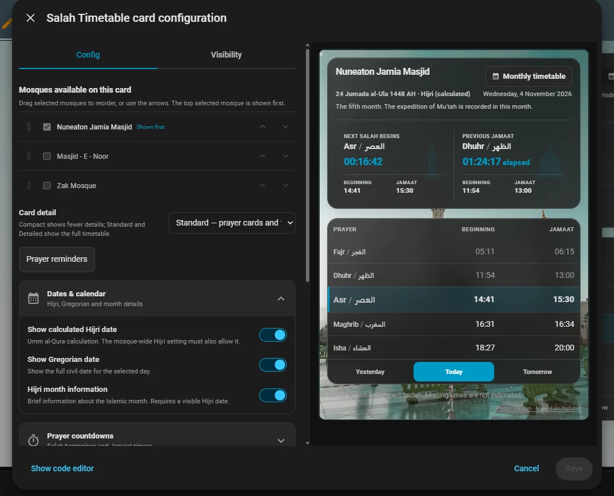

Select and order the mosques available on the card, choose its detail level,
then expand the relevant settings group. The six-dot drag grip supports pointer
reordering; up/down buttons also work with touch and keyboard. The editor
scrolls on smaller displays, so lower settings can be below the initial view.

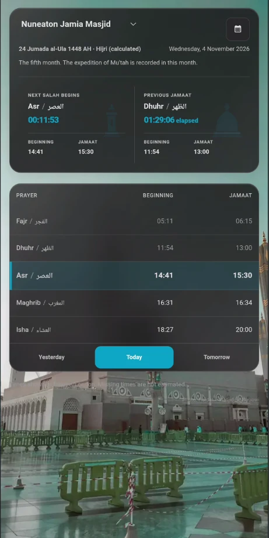

The screenshots show a real configured mosque name and illustrative published
timetable values. They are not universal prayer times, and the background
photograph is decorative.

## Jamaat changes and timetable health widgets

Version **3.5** introduces custom Lovelace dashboard widgets that reuse the
integration's existing approved Prayer timetable data. They are available
alongside the main Salah Timetable card; existing cards retain their appearance
unless you explicitly add a widget or enable an optional panel. No additional
app, template sensors or separate widget download is required.

In the main card editor, enable **Upcoming Jamaat changes** or **Timetable health**.
The changes panel compares today's and tomorrow's approved congregation times in
the mosque's timezone. It shows published times and an earlier/later difference
when the same prayer field has one time on each day. Jumu’ah remains separate
from ordinary Dhuhr and Khutbah. Multiple congregations are shown as published
lists without guessing which sessions correspond. Missing data is shown as
unavailable, never as an unchanged or cancelled congregation. Daylight-saving
offset changes alone do not create a prayer-time change.

Health shows approved date coverage, named missing required fields, staged updates
awaiting review and source-check problems. Remaining coverage stops at the first
gap and excludes today. A pending manual import is shown even without an automatic
URL source. Administrators can open the selected mosque's integration settings to
import or review data. The widget does not approve an update or expose staged times.
Connection problems mark the displayed information as stale.

For separate dashboard placement, choose **Edit dashboard → Add card → By card**
and search for **Salah**. Select **Mosque selector**, **Upcoming Jamaat changes**
or **Timetable health**, or the original **Salah Timetable** card. These are
**Home Assistant dashboard cards**, not Android/iOS home-screen widgets.

**Mosque selector** is an optional shared controller for dashboards built from
several cards. It is not necessary when using only the main card, which already
has its own mosque selector. **Upcoming Jamaat changes** compares today with
tomorrow; **Timetable health** reports approved coverage and any review action.
Standalone widgets size to their content and have no photograph by default.
Select enabled mosques in each card's editor before saving.

### Synchronise mosque selection across widgets

Most dashboards need only the main Salah card: its existing mosque dropdown already
switches the whole card, so no separate selector widget or synchronisation is needed.

For a dashboard made of separate status cards, use the optional **Mosque selector**
card as one shared control. In each participating card's editor open **Advanced**,
enable **Synchronise mosque selection** and enter the same **Group name** (for
example `home`). The main Salah card can also be the group controller instead of
a separate selector. Linking is off by default; a new group starts with `home`.

Linked standalone status cards display the mosque name without repeating another
dropdown. Unlinked cards keep their own mosque selector. The dedicated Mosque
selector and the main Salah card always retain theirs, so users can change the
active mosque. Groups are local to one dashboard view and do not change integration
settings, another browser or another user's display. Selection is temporary: the
first connected card supplies the initial mosque, and later members adopt it.
Configure matching enabled mosque lists for a predictable default.

Every widget retains its enabled-mosque restrictions. If the selected mosque is
excluded, missing or unavailable, the widget explains the problem instead of
silently showing another mosque. Editor/device previews never switch live widgets.
Grouping shares only mosque selection; day and month browsing remain local to each
card. Standalone status widgets always describe the current mosque-local day.
Standalone widget previews use their natural content height rather than filling
the entire viewport; dashboard Sections layouts likewise use automatic row height.

The additional YAML options are:

| Option | Values and default |
| --- | --- |
| `show_jamaat_changes` | `false`; enable the embedded Today/tomorrow comparison |
| `show_timetable_health` | `false`; enable the embedded approved-data health overview |
| `selection_group` | Empty by default; a shared name links mosque selection within a dashboard view |

Standalone types are `custom:salah-widget-mosque-selector`,
`custom:salah-widget-jamaat-changes` and `custom:salah-widget-timetable-health`.
The graphical editor preserves each type and provides its relevant options.

#### Example: one selector controlling two status cards

Add three separate cards to the **same dashboard view** and open each card's
**Advanced** settings. Enable **Synchronise mosque selection** and use the
same group name (`home`). Use the following YAML only if you prefer manual
configuration; replace the entity with a real **Prayer timetable** sensor from
your own mosque:

```yaml
type: custom:salah-widget-mosque-selector
entity: sensor.my_mosque_prayer_timetable
selection_group: home
```

```yaml
type: custom:salah-widget-timetable-health
entity: sensor.my_mosque_prayer_timetable
selection_group: home
```

```yaml
type: custom:salah-widget-jamaat-changes
entity: sensor.my_mosque_prayer_timetable
selection_group: home
```

Changing the selected mosque in the first card updates both linked status
cards. Alternatively, assign `selection_group: home` to the main Salah
Timetable card and use its built-in selector; you do not need the separate
Mosque selector card. Leaving the group empty keeps a card independent.

**Troubleshooting:** If a status card says **No approved timetable**, approve
the selected mosque's publication in its integration settings. The Jamaat
comparison needs approved times for *both today and tomorrow*; missing times
are not treated as changes. If widgets do not switch together, verify the exact
group name, enabled mosque lists and that they share one dashboard view.
Browser sessions, other dashboards and devices are not synchronised.

## Visual layouts and standalone sections

The **Layout** tab and the ten standalone card sections are available from
v3.6.0.
The card editor has **Settings** and **Layout** tabs. Settings retains
the existing grouped controls. Layout arranges only this card; it does not move
other Home Assistant cards or change another dashboard's configuration.

Choose a preset, or drag a section's handle to reorder it. **Move up** and
**Move down** provide the same ordering with keyboard and touch controls. Each
section has a visibility checkbox and a **Full width / Half width** selector.
Half-width sections share a row when the card is wide enough and stack on narrow
cards. Reading and keyboard order follow the saved order.

| Preset | Visible order |
| --- | --- |
| Countdown-focused | Mosque selector, dates, Salah, Jamaat, changes |
| Balanced | Mosque selector, dates, Salah, Jamaat, timetable, changes, health, Ramadan |
| Timetable first | Mosque selector, dates, timetable, Salah, Jamaat, changes, health, Ramadan |
| Ramadan | Mosque selector, dates, Ramadan, Salah, Jamaat, calculated night information, timetable, changes, health |
| Wall display | Mosque selector, clock, dates, Salah, Jamaat, timetable, changes, health, Ramadan |

Salah and Jamaat default to half width; other sections default to full width.
Wall display also enables kiosk mode. Presets retain selected mosques, language,
date preferences and Sehri/Iftar countdown choices. Ramadan and calculated night
sections still need their applicable approved data; selecting a preset does not
activate Ramadan or supply missing prayer times.

**Phone**, **Tablet** and **Desktop** previews render the actual card at 360, 768
and 1280 CSS pixels, scaled to fit the editor. Preview selection is isolated from
live widget groups. **Reset layout** removes the custom arrangement and restores
section visibility defaults for the selected detail/kiosk mode, keeping mosque,
language, photograph and section-specific settings.

Without a custom arrangement, the established Compact/Standard/Detailed and kiosk
layouts remain unchanged. With an arrangement, the selected sections determine
what appears, including dates and timetable in Compact; detail level determines
presentation and detailed prayer-row extras. Kiosk arrangements reuse the live
clock, larger typography, published prayer tiles and fullscreen control. Timetable
day/month controls stay with the timetable; attribution stays outside movable
sections. Live Today sections retain their day-navigation applicability.

Every movable section also has its own **Add card** entry:

| Section | Standalone type |
| --- | --- |
| Mosque selector | `custom:salah-widget-mosque-selector` |
| Gregorian/Hijri dates | `custom:salah-widget-dates` |
| Mosque-local clock | `custom:salah-widget-clock` |
| Next Salah | `custom:salah-widget-salah` |
| Contextual Next/Previous Jamaat | `custom:salah-widget-jamaat` |
| Daily timetable | `custom:salah-widget-timetable` |
| Ramadan | `custom:salah-widget-ramadan` |
| Calculated night information | `custom:salah-widget-night-calculations` |
| Upcoming Jamaat changes | `custom:salah-widget-jamaat-changes` |
| Timetable health | `custom:salah-widget-timetable-health` |

Standalone editors expose the relevant settings under **Advanced**, rather than
an arrangement editor or a switch to hide the card's only section. Inactive Ramadan
and unavailable night calculations show an explanation instead of an empty card.
Dates and clock use the current mosque-local day; timetable browsing remains local.

For YAML, use the optional `arrangement` alongside the ordinary visibility flags:

```yaml
type: custom:salah-timetable-card
entity: sensor.example_mosque_prayer_timetable
show_jamaat_changes: true
show_timetable_health: true
arrangement:
  sections:
    - id: dates
      width: full
    - id: salah
      width: half
    - id: jamaat
      width: half
    - id: timetable
      width: full
```

Section IDs are `mosque_selector`, `dates`, `clock`, `salah`, `jamaat`, `timetable`,
`ramadan`, `night_calculations`, `jamaat_changes` and `timetable_health`. Omitted
positions append in their default order; visibility still follows the `show_*`
options. Unknown or duplicate IDs and unsupported widths are rejected. The legacy
`layout` option keeps its existing meaning.

Additional section switches are `show_mosque_selector` (default true), `show_dates`
and `show_timetable` (default visible outside non-kiosk Compact), and `show_clock`
(default visible in kiosk). Existing countdown/Ramadan/night switches remain the
visibility controls for those sections. The two status switches default false.

## Day navigation

The **Yesterday / Today / Tomorrow** controls sit in the timetable footer.
Today is selected initially.
The header's Gregorian **and calculated Hijri dates**, plus the contextual
Hijri month description, update with the selected day whenever those fields
are visible (Standard/Detailed; Compact hides those dates). The timetable does not repeat
the Gregorian date when it is already in the header; a date label remains if
the Gregorian header is disabled or the card is in Compact mode.
All three views share the same table styling, labels, time formatting and responsive
layout. Yesterday and Tomorrow hide **both** prayer summary cards, live countdowns,
current-prayer highlighting, and today's Ramadan/status sections. They show only
the selected day's actual approved beginning and Jamaat timetable. This also
applies when Compact is selected: its adjacent-day views show the full table.
On a date with no approved times, the footer stays visible beneath an unavailable
message so users can return to Today.

Missing approved rows display **No approved timetable is available for this date**
rather than copying today's times. Date selection does not modify stored data or
Home Assistant sensor state.

## Card detail levels

| Level | Today's display |
| --- | --- |
| Compact | Next Salah countdown with beginning and Jamaat, plus context-aware upcoming/previous Jamaat; active Ramadan details when enabled |
| Standard (default) | Both matching prayer cards, full timetable, Hijri date (if enabled), and active Ramadan details |
| Detailed | Standard plus published Fajr sunrise/end and second Friday khutbah (if present) |

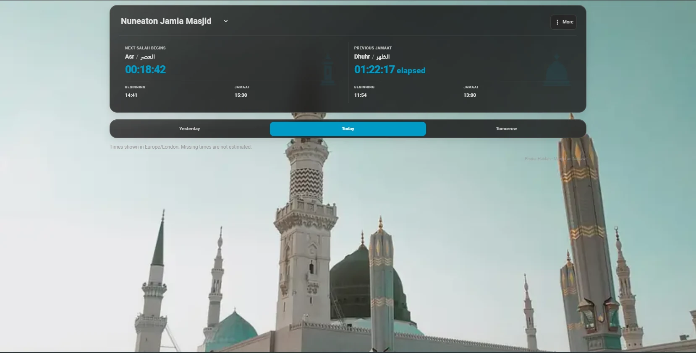

**Next Salah** always means the next *beginning* time, even if the current
prayer's Jamaat is still upcoming. The countdown and published times from that
event's actual date appear together. **Next Jamaat** counts down while the
current prayer's congregation is still approaching; at its exact instant the
same panel becomes **Previous Jamaat** and shows elapsed time.
The summary panels sit side by side on most phones and tablets, stack on very
narrow cards, and can be hidden independently. On Yesterday and Tomorrow the
header remains while live countdowns are hidden. Decorative silhouettes do not
identify the selected mosque or carry timetable data.

Fajr end is the *published sunrise*, never a calculated estimate. Published
Jumu’ah congregations remain in Dhuhr's Jamaat row, and the separately published
second khutbah (if any) is not treated as a Jamaat. Missing times are displayed
as unavailable rather than inferred. Ramadan details are shown in all three display levels when Ramadan is active and the card's Ramadan details option is enabled.


## Device screenshots

The screenshots below illustrate the released card/editor layouts on desktop,
mobile and tablet. The gallery shows representative configurations, not every
v3.1.0 countdown visibility or paired-alignment option. The screenshots come
from one configured mosque and are not authoritative prayer schedules.
Click a screenshot for its full resolution; the bundled photograph is decorative.

### Kiosk / wall display (v3.0)

<a href="screenshots/showcase/desktop/kiosk-v3.webp">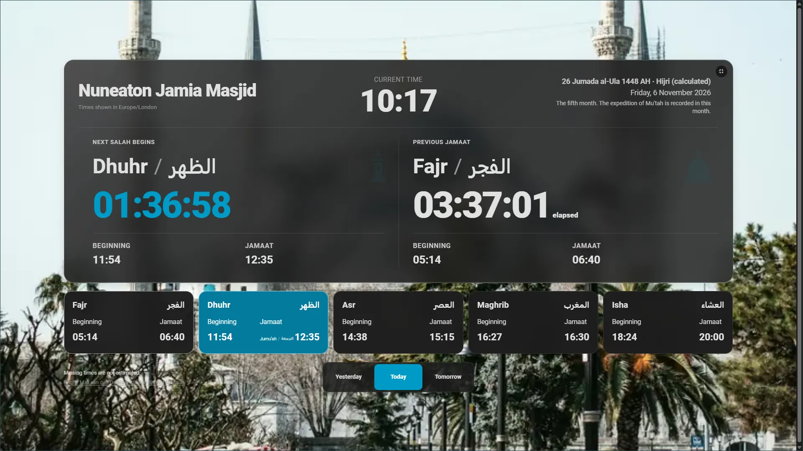</a>

*Actual Home Assistant kiosk capture supplied by the maintainer on 6 November 2026.
The times belong to the configured mosque; the background photograph is decorative
and its original licence remains separate. This shows the released v3 kiosk design
with both countdowns enabled; v3.1.0 also supports the single-countdown layout
and aligned paired countdown rows. Device size and optional settings can vary.*

See [Wall and tablet display](#wall-and-tablet-display) for setup, day navigation
and fullscreen behaviour. Compact, Standard and Detailed screenshots below
illustrate the **non-kiosk** layouts, which remain available.

### Daily display modes

| Mode | Desktop | Mobile |
| --- | --- | --- |
| **Compact** | <a href="screenshots/showcase/desktop/compact-card.webp"></a> | <a href="screenshots/showcase/mobile/compact-card.webp">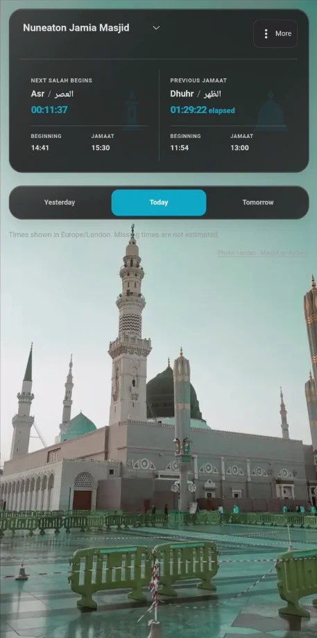</a> |
| **Standard** | <a href="screenshots/showcase/desktop/standard-card.webp">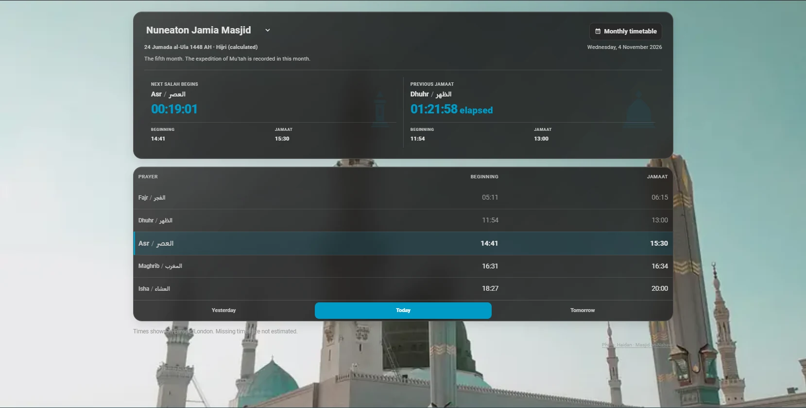</a> | <a href="screenshots/showcase/mobile/standard-card.webp"></a> |
| **Detailed** | <a href="screenshots/showcase/desktop/detailed-card.webp">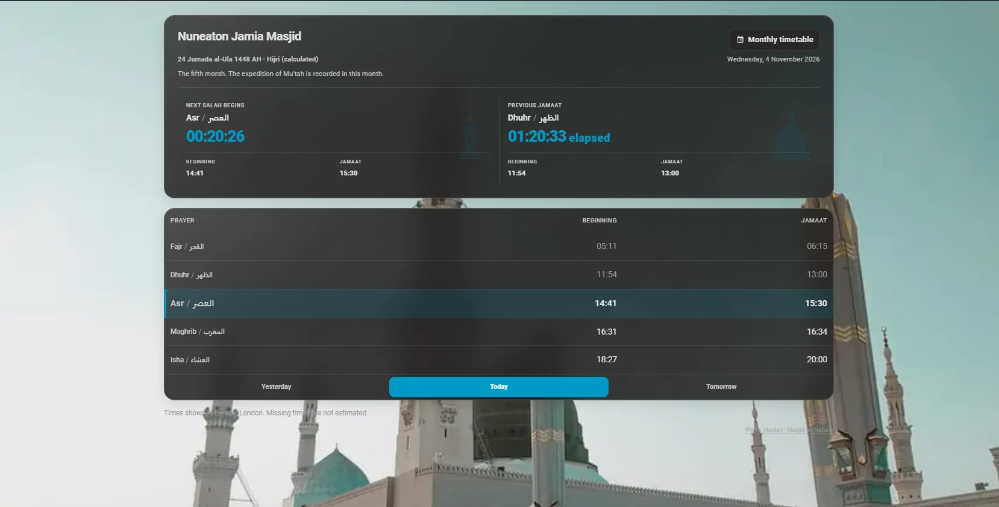</a> | <a href="screenshots/showcase/mobile/detailed-card.webp">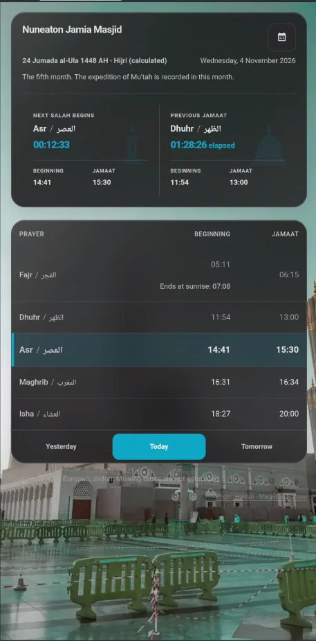</a> |

In Compact Today, the short summary deliberately leaves more of the photograph
visible; it does not stretch the countdown panels to fill the screen. Standard
and Detailed include the published daily prayer table. Yesterday and Tomorrow
show the selected date's approved table instead of live countdown panels.

### Monthly timetable and Compact actions

| Interaction | Desktop | Mobile |
| --- | --- | --- |
| **Compact More menu** | <a href="screenshots/showcase/desktop/compact-monthly-menu.webp">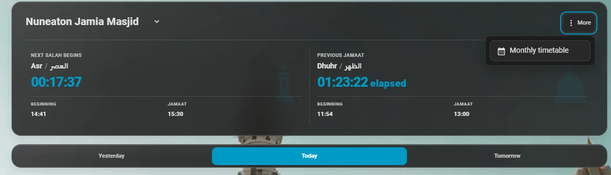</a> | <a href="screenshots/showcase/mobile/compact-monthly-menu.webp">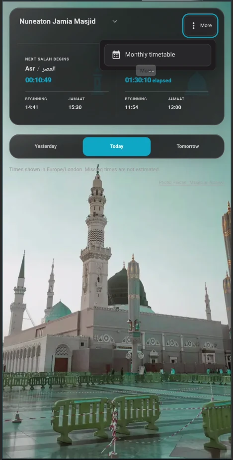</a> |
| **Compact monthly timetable** | <a href="screenshots/showcase/desktop/compact-monthly-view.webp">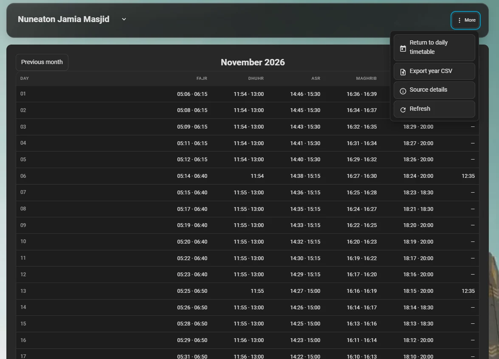</a> | <a href="screenshots/showcase/mobile/compact-monthly-view.webp">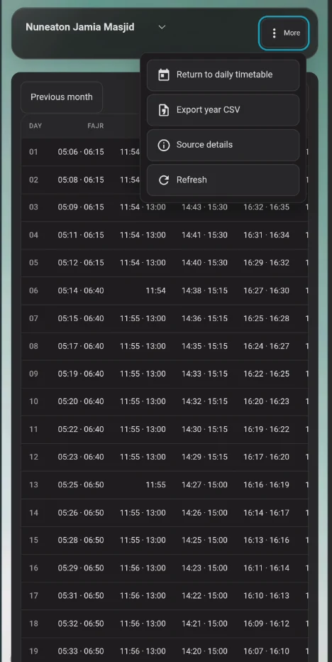</a> |
| **Standard monthly timetable** | <a href="screenshots/showcase/desktop/standard-monthly-view.webp">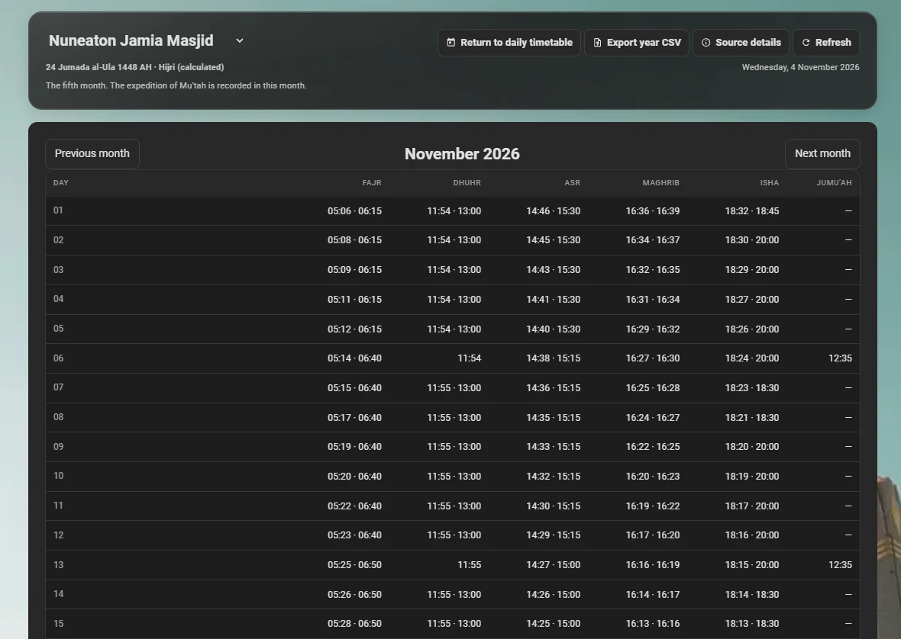</a> | See the Detailed mobile month browser below |
| **Detailed monthly timetable** | <a href="screenshots/showcase/desktop/detailed-monthly-view.webp">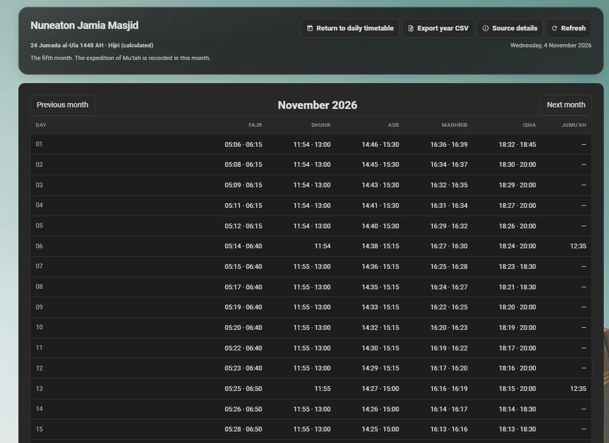</a> | <a href="screenshots/showcase/mobile/detailed-monthly-view.webp">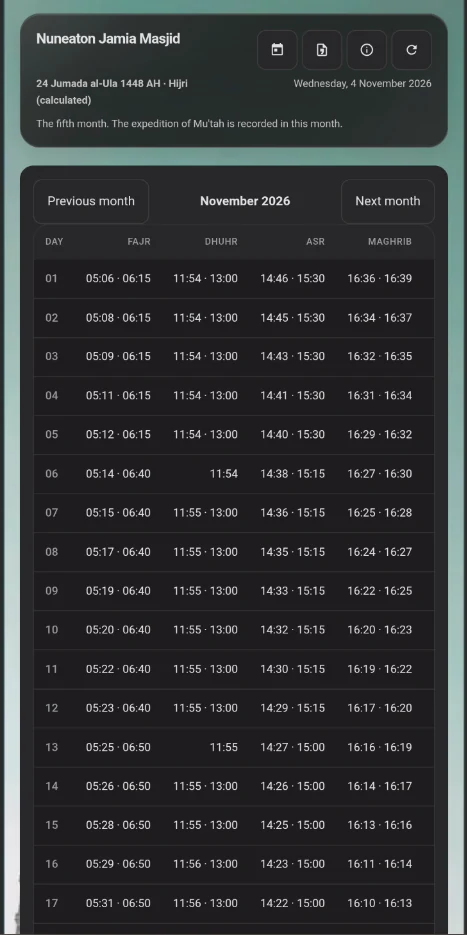</a> |

### Card editor and tablet

| Desktop editor | Tablet editor | Tablet Standard card |
| --- | --- | --- |
| <a href="screenshots/showcase/desktop/card-editor.webp"></a> | <a href="screenshots/showcase/tablet/card-editor.webp">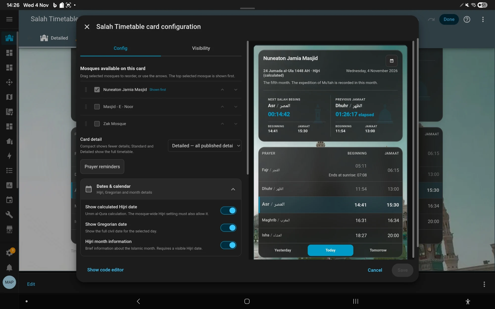</a> | <a href="screenshots/showcase/tablet/standard-card.webp">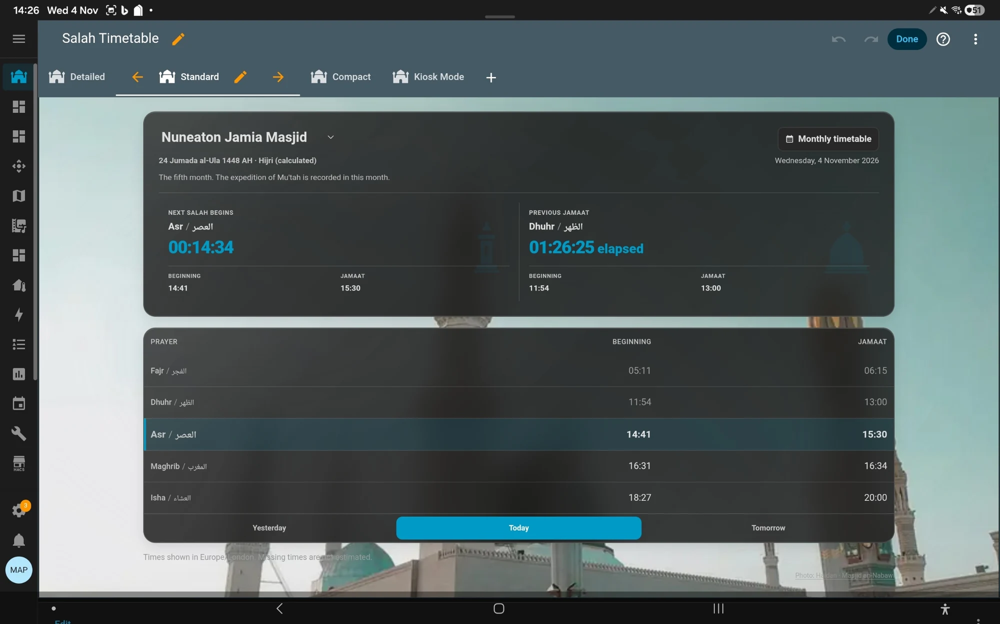</a> |

The graphical editor removes the duplicate sensor selector and Title field;
the mosque checkbox order determines the initial mosque. Compact exposes the
monthly timetable through **More**, while Standard/Detailed use an inline
header action. No third-party card-mod theme is required for these controls.

## Timing and boundaries

Next Salah and the contextual Next/Previous Jamaat are selected independently from the published
absolute event timeline. After Isha, the next Salah uses tomorrow's actual Fajr
record; missing tomorrow data yields an unavailable countdown. Its time grid also
uses tomorrow's actual published Fajr, Jamaat and sunrise, never today's row. At a prayer
beginning boundary, the next Salah advances to the next published beginning.
Events are drawn from yesterday, today and tomorrow, including leap-year and
year-end transitions. The card updates the live countdown in the browser without
per-second Home Assistant state writes.

Today's full timetable highlights the relevant prayer and dims completed rows;
Yesterday and Tomorrow have no current-prayer highlighting. Tables retain semantic
headers, LTR-isolated numeric times, a keyboard-focusable scroll region, and
responsive handling for narrow screens.

## Language and direction

The card editor offers **Automatic (Home Assistant)**, **English** and
**العربية**. Automatic uses Arabic labels and right-to-left layout for an Arabic
Home Assistant interface, with English label fallback for other interface
languages. Supported Home Assistant regional locales are retained for date and
number formatting; choosing an explicit card language uses a matching regional
locale when available.

Enable **Bilingual prayer labels** to show both English and Arabic names, with
the selected language first. Each name carries its own language and direction;
clock values remain isolated in left-to-right order in both layouts. This applies
to known prayer names in the timetable and event panels. Custom mosque titles
remain user-supplied text. Language changes affect presentation only: prayer
keys, entity IDs, stored values and event identities stay unchanged.

The bundled card/editor supports the described language and direction options.
Additional integration translations and reviewed Arabic wording are deferred.
Automated browser checks do not establish full Arabic/RTL acceptance on physical devices.

## Monthly timetable and CSV/source information

Enable **Monthly timetable, CSV export and source details** in the card editor
(`show_month_view: true`). In **Standard** and **Detailed**, the labelled
**Monthly timetable** button sits right-aligned on the same row as the mosque
name, above the Gregorian date. Its calendar icon and label share the same text
size. On narrow cards, the label hides to keep the title readable; the button's
accessible name and tooltip remain available. In **Compact**, open **More** in
the header and select **Monthly timetable**. Its dropdown floats over the card
rather than moving the countdown panels or timetable.

While browsing a month, **Return to daily timetable**, **Export year CSV**,
**Source details**, and **Refresh** appear in the same location:
Compact's More menu or the Standard/Detailed header action strip.
The calendar opens a Gregorian month browser. Previous/next month and Refresh
retrieve at most 31 days of **approved effective** times for the selected mosque; missing
dates and prayer fields display as missing, never calculated or filled.
Ramadan overrides apply only when explicitly active for those dates.
The card's original Yesterday/Today/Tomorrow and live countdowns are unchanged.

**Export year CSV** downloads a standard UTF-8 CSV for the currently viewed
Gregorian year, including the mosque's timezone, all canonical published
fields and multi-time Jumu’ah values. It contains blank cells for missing
fields/dates, and exports effective approved rows only (not source documents).
**Source details** shows a redacted approved-source summary: date coverage,
format, number of rows and check status, without original PDF, raw URL,
credential-like source contents or pending-import data.

These features use authenticated Home Assistant WebSocket requests, checking
the viewer's permission to read the selected mosque's dashboard entity. This
does not introduce a public download endpoint. Depending on the Android
WebView, the browser download prompt may vary.

## Calculated night information

Enable **Show calculated night midpoint and final third** in the card editor
(`show_night_calculations: true`) to show derived values in the Standard or
Detailed **Today** view. The interval runs from today's approved Maghrib
beginning to the following day's approved Fajr beginning. The midpoint is
halfway through that elapsed interval; the final third starts two-thirds of
the way through it. Elapsed UTC time preserves the calculation across DST
changes, and the card displays the result in the mosque's timezone.

Both approved anchors must exist and form a valid night interval. Missing
anchors leave this section unavailable; no sunset or Fajr time is inferred.
These values are labelled calculated and do not replace published prayer
times, create sensors/calendar events or change Ramadan activation.

## Wall and tablet display

Enable **Kiosk / wall display mode** in the card editor (`kiosk_mode: true`)
for the dedicated v3 wall-screen layout shown in the
[approved kiosk screenshot](screenshots/showcase/desktop/kiosk-v3.webp). The card uses a responsive three-zone
display modelled on the published prayer-screen reference. Its main glass panel
has the mosque name and optional timezone on the left, a live clock in the
middle, and configured Gregorian/Hijri dates on the right. The clock uses the
mosque's actual timezone and the existing 12/24-hour preference. The Hijri
date also respects the mosque-level visibility preference and the optional
published-Maghrib day boundary. When month information is enabled, it appears
with the date details.

When both countdowns are visible, the main panel gives Next Salah and
contextual Previous/Next Jamaat equal widths, matching font sizes and vertical
spacing. Cyan marks the next Salah, and Jamaat uses a neutral colour. When
only one countdown is visible, it uses the [single-countdown timeline layout](#single-countdown-timeline).

If the next Salah begins on the following *mosque-local* civil day, a
**Tomorrow** indicator appears beside Next Salah Begins. The daily tiles
continue to describe the selected day's published timetable, so the two
different Fajr times are not mistaken for a disagreement.

Below the hero are five prayer tiles (Fajr, Dhuhr, Asr, Maghrib, Isha),
populated only from the **selected day's published rows**. The next published
beginning is highlighted, the most recently begun prayer is distinguished,
and a subtle outline marks the upcoming published Jamaat when it matches
one of today's congregations. No missing times are estimated. Dhuhr retains
published Friday congregations where available, and prayer labels follow
the configured language and bilingual setting.

The bottom row contains the missing-time note (when timezone/help text is
enabled), Yesterday / Today / Tomorrow controls and optional monthly
timetable actions. Instead of the old footer button, a **30px icon-only
fullscreen toggle** sits 12px from the top-right corner *inside* the glass
summary, absolutely positioned so it does not shift the header or prayer
panels. Tap it to enter fullscreen; tap it again to return to the prior
dashboard view. Its icon and accessible label update automatically when
fullscreen ends, including when pressing Escape. The selected day controls both the tiles
and dates; the clock always displays the current time. The monthly view remains
available via the existing controls, and optional Ramadan/night details remain
available below the main display. The mosque photograph fills the entire kiosk
canvas with `cover` even when normal dashboard day-tab sizing is cached. Its
photographer credit appears in the left footer, away from the fullscreen
icon, with wrapping and responsive stacking so it cannot overlap. The kiosk avoids
a duplicate outer viewport-height requirement and reserves a small amount
of space for Home Assistant's surrounding dashboard margins. This reduces
unnecessary desktop scrolling without hiding overflow when mobile content is
naturally taller than the screen. The five prayer tiles use stronger glass
contrast and larger published-time labels;
the upcoming prayer tile uses a deeper highlight and inactive date tabs remain
legible. Pointer clicks clear fullscreen focus without hiding keyboard focus.

Kiosk mode intentionally replaces the ordinary scrolling timetable with the
five-tile display regardless of Compact, Standard or Detailed selection. Wider
screens use a three-column header and put two visible countdowns side by side.
Narrow screens stack the header and paired countdowns and wrap the tiles and bottom controls to prevent
clipping. The whole hero, five-tile strip and footer group is centred both
horizontally and vertically within the visible kiosk canvas, including browser
fullscreen and viewport resizing. On short or narrow displays where content
cannot fit, alignment safely starts at the top and content scrolls rather than
being clipped. The editor retains normal top-aligned behaviour. Use a full-width
Home Assistant dashboard view on a dedicated wall display.

The fullscreen button requires a tap or click and browser support. If the
browser or WebView rejects fullscreen, the larger card presentation remains
usable. This option does not lock the device, manage screen sleep, provide
announcements or change Home Assistant's dashboard/navigation settings.

## Dates and customization

In Standard/Detailed mode, the **primary Hijri header** uses the browser's **Umm al-Qura** calendar to
convert the mosque's Gregorian timetable date, displaying its Islamic day,
**named Hijri month** and year. The Gregorian date is a separate secondary
header field; hide it via the card's `show_gregorian_date: false` switch without
hiding Hijri. Both default to visible for existing cards.
By default it advances at mosque-local midnight. A card can optionally
advance the **Today** Hijri header and month description at that day's
**published Maghrib beginning** (`hijri_day_boundary: maghrib`). Yesterday
and Tomorrow retain their own selected Gregorian date's Hijri conversion.
When published Maghrib is absent, the header does not infer sunset; it
remains on the civil-date convention. The option never changes the Gregorian
date, prayer events, approved values or Ramadan confirmation.
The default is visible; choose
**Show full calculated Hijri date on dashboards** during initial mosque setup,
or change it later via **Configure → Mosque settings**. Older mosque entries
without a stored preference default to visible. The card editor's
`show_hijri_date` option is an additional per-card hide switch: the header is
visible only if **both** the mosque and that card permit it.
The optional −3 to +3 day adjustment changes only the displayed Hijri date. It does
not shift imported records, prayer events, Ramadan confirmation or Ramadan's separate
date adjustment. The date is labelled calculated; unsupported browsers show
**Hijri date unavailable** rather than silently substituting another calendar.

The following are supported *card-specific* configuration options. The graphical
editor exposes the current controls; legacy YAML settings are identified below.
The mosque-wide Hijri preference is managed separately in the integration settings:

| YAML option | Values and default |
| --- | --- |
| `entity` | The initial/primary `sensor.*_prayer_timetable` entity on the card |
| `title` | Optional text, at most 100 characters; overrides the primary mosque's display label on this card |
| `mosque_entities` | Optional **ordered** list of enabled Prayer timetable sensor IDs; the first is the default mosque. Omit to show all configured mosques (legacy behaviour); requires at least one when set |
| `language` | `auto` (default), `en`, `ar`; automatic follows the HA interface language with English label fallback |
| `bilingual_prayer_labels` | `false` (default); show English and Arabic known prayer names |
| `detail_level` | `standard` (default), `compact`, `detailed` |
| `kiosk_mode` | `false` (default); larger responsive wall/tablet presentation with optional user-gesture fullscreen button. Does not lock the device, hide the HA toolbar or alter data. |
| `layout` | Legacy `compact` maps to Compact; `expanded` maps to Standard if no `detail_level` is saved |
| `mode` | Legacy setting ignored; no longer exposed in the editor |
| `time_format` | `24h` (default), `12h`; applies to every absolute time |
| `show_salah_countdown` | `true` |
| `show_jamaat_countdown` | `true` |
| `show_hijri_date` | `true`; further hides the mosque-enabled full Hijri date on this card |
| `show_gregorian_date` | `true`; independently displays the secondary Gregorian date |
| `show_hijri_month_info` | `true`; shows a short, non-repeating description directly beneath the visible Hijri date in the header; hidden when the Hijri date is hidden |
| `hijri_adjustment` | Whole days −3 through +3; default `0` |
| `hijri_day_boundary` | `midnight` (default) or `maghrib`; optional Today Hijri header transition at approved published Maghrib |
| `show_ramadan_details` | `true`; controls the entire Ramadan section |
| `show_night_calculations` | `false` (default); in Standard/Detailed Today view, display night midpoint and final-third start calculated between approved Maghrib and the following day’s Fajr |
| `show_month_view` | `false` (default); enables read-only monthly timetable browsing, CSV year export and safe source details in the card |
| `show_sehri_countdown` | `true`; hiding retains the displayed absolute time |
| `show_iftar_countdown` | `true`; hiding retains the displayed absolute time |
| `show_timezone_note` | `true`; controls the timezone and missing-time note |
| `show_mosque_background` | `true`; legacy YAML visibility flag. The editor sets it via the unified background dropdown; `false` disables the photograph without clearing its saved selection |
| `mosque_background` | `daily` (default); `none`, or a bundled mosque ID for a fixed photo. In the editor, Off sets `show_mosque_background: false` |

### Single-countdown timeline

When you hide either countdown, the remaining panel uses a centred heading
and a tile for the published **Beginning** and **Jamaat** times. The tile sits
beside the countdown on wider cards and below it on narrow cards. In Arabic,
the wide layout and the timeline read right to left. The decorative silhouette
sits at the far right. This layout applies in Compact, Standard, Detailed and
kiosk, as well as standalone prayer widgets and individual countdown sections
in custom layouts.

Before Salah, the timeline shows the total interval between Beginning and
Jamaat. Once Salah begins, Next Salah advances to the next prayer. The
contextual Jamaat panel shows progress and the remaining minutes until Jamaat,
then a completed line and the minutes since Jamaat while that congregation
is the previous one. The strip appears only when both published times form a
positive interval. Available times still appear in the tile when the timeline
is unavailable.

### Paired countdowns and other options

When both countdowns are visible in a built-in layout, the panels sit side by
side where space allows, with equal-width halves in kiosk. The Next Salah and
contextual Jamaat headings, live clocks and published Beginning/Jamaat rows
align from the top. An optional Fajr sunrise note sits beneath the relevant
panel without shifting its neighbour.
Narrow side-by-side cards reserve matching heading and countdown row heights
when the Jamaat label or elapsed text wraps; once mobile panels stack, that
extra space is removed. Hiding both leaves the mosque header and
the timetable **when Standard or Detailed is selected**; Compact still
omits today's full timetable (but retains the date footer). Connection warnings and narrow-card
scrolling guidance remain available when the timezone note is hidden. Taraweeh
belongs to the Ramadan details section. Countdown durations use hours/minutes/seconds
with a day prefix when needed, independent of 12/24-hour time format.
The legacy `mode` option is accepted but ignored for all cards. The Jamaat panel automatically
switches between the upcoming congregation and the previous one.

The four **coming soon** Islamic-history settings are disabled; saved values
remain inert. The separate Hijri month description follows the selected day
and is visible only when the Hijri date is shown. See [Hijri month information](#hijri-month-information-and-future-history-options).

## Optional mosque photograph backgrounds

The card bundles 20 WebP photographs from free Unsplash photo pages. They
are served from the integration itself, without remote requests or an Unsplash
account. Photo backgrounds rotate once per mosque-local published date by
default and do not repeat until all 20 have appeared.

In **Appearance → Mosque background**, choose a fixed photograph, daily
rotation or **Off — no background**. The retired `mosque_background_opacity`
option is ignored and stripped when saved configuration is normalised.

In normal dashboard viewing, the background fills the card width and the
**visible screen space remaining below its actual top edge** (allowing a small
bottom gap). The card measures its position after layout and adjusts when the
window or mobile visual viewport changes. Short Compact or Yesterday/Tomorrow
views therefore do not create scrolling merely to accommodate the photo.
A full timetable or other content taller than the available height expands
naturally and the dashboard can scroll. Other cards above the timetable are
also accounted for; no fixed Home Assistant header height is assumed.

In dashboard edit mode, the card also recognises Home Assistant's desktop
and tablet editing wrappers (`hui-card-options` and `hui-card-edit-mode`).
Those layouts do not always forward the card's preview flag. In an editor
wrapper or standalone card preview, the viewport minimum height is removed.
Editing preserves the **same readable, vertically stacked card dimensions
as normal viewing**. The card no longer attempts to shrink typography,
rearrange its prayer panels or add a nested scrollbar. All prayer rows and
controls remain in normal document flow.

In a Home Assistant **Panel** dashboard, the parent dashboard reserves a
full-height editing slot and positions its native **Edit** footer underneath.
The button has been observed visible and clickable in Compact, Standard and
Detailed during manual desktop testing without card-mod. Depending on viewport
height, however, the shorter Compact card can leave empty editor space, and
the native action may still require scrolling on smaller screens. That space
belongs to Home Assistant's Panel layout, not the Salah Timetable card.
For content-following edit controls, a **Sections** or **Masonry** dashboard
view can be preferable.
The normal available-viewport background is restored on exiting editing.
Home Assistant still controls the parent column width; use a
full-width section for a wider display. Switching days retains
the photograph framing; viewport resizing can reframe it. Full-screen kiosk
mode continues to fill its screen.

High-contrast and reduced-transparency preferences hide the photo and use opaque
panels. Browsers without backdrop filtering also use opaque panels. The photo is
decorative: it does not identify the configured mosque or affect prayer data.
Photographer credit links to the original photo; see the
[asset inventory](asset-provenance.json) for sources and licences.

## Ramadan controls

Use the mosque integration's **Configure → Ramadan settings**; the card reflects
these settings automatically.

Automatic activation requires a separately confirmed Gregorian date range;
imported or calculated Hijri dates do not confirm Ramadan. Manual on stays active
until changed, and Off disables the override. During active dates the card shows
effective approved values and, when enabled, Sehri/Iftar countdowns. An unpublished
Iftar may use the effective Maghrib beginning; an untimed Taraweeh shows **After Isha
Jamaat** without creating a timestamp. For the window, source-selection and fallback
rules, see [Ramadan settings](import_review.md#ramadan-settings).

## Resource troubleshooting

The integration serves assets under a content-fingerprinted URL and automatically registers the card in
storage-mode Lovelace resources. With YAML-managed resources it uses HA's supported
extra-JavaScript registration without editing your YAML. A second manual resource
is normally unnecessary.

If the card remains unavailable after restarting the integration and reloading the
browser, check Home Assistant logs for resource-registration errors. As a fallback,
add this **JavaScript module** resource through **Settings → Dashboards → Resources**
(enable Advanced Mode in your HA profile if the Resources option is hidden):

```text
/salah_timetable/salah-timetable-card.js
```

Reload the page after saving. Check for obsolete or duplicate manual resources if an
old card version persists. The integration updates its own registration when the
frontend changes, including when testing a PR with the same release version. Its
registered URL includes a content fingerprint, so relative helper imports also
load the matching build. Keep the automatically registered resource and remove
obsolete manual duplicates that may load an older definition first. YAML-managed
manual resources remain yours to edit; do not keep an old manual card URL alongside
the integration's automatic module registration.

### Custom cards show Configuration error after a cold dashboard load

Home Assistant may create a custom card before its JavaScript module completes
registration. On some frontend versions, the scoped custom-element registry can
also replace the native registry after the module evaluates, leaving a previously
defined element invisible to Lovelace. This is particularly noticeable on a
cold-started Chromecast/DashCast dashboard or a `panel: true` view.

The bundled Salah Timetable card now **rechecks and registers both the card and
its editor against the active custom-element registry** after Home Assistant
initialises. This needs no dashboard configuration change or Cast-specific
resource injection. It does not recast the screen or force a page reload.

If a **Configuration error** remains:

1. Verify the card resource was loaded and registered exactly once. Remove stale
   extra copies of `salah-timetable-card.js` from Resources; do not manually
   import a second URL just to hide a loading error.
2. Check your browser console for a `Failed to fetch dynamically imported
   module`, authentication, content-type, or syntax error, or a
   `Salah Timetable: could not register` warning.
3. If using a Cast device, load the exact same dashboard URL in a clean browser
   session to distinguish a missing-module error from a receiver limitation.
4. If only other third-party custom cards fail, update those card modules. This
   integration can only repair registration for its **own** custom elements.
5. Report your Home Assistant version, the precise error and the registered
   module URL; do not share access tokens or private dashboard URLs.

A successful `customElements.get("salah-timetable-card")` check establishes
registration in that browser only; it does not prove the Cast receiver rendered
the card or that HA entities were loaded. Home Assistant frontend issues
[52570](https://github.com/home-assistant/frontend/issues/52570) and
[52960](https://github.com/home-assistant/frontend/issues/52960) document
these distinct frontend timing and registry problems.

If the card reports a missing entity, choose the mosque's Prayer timetable sensor
again. If prayer values are unavailable, check the approved source's date coverage,
field mappings and mosque timezone. An empty mosque has no prayer times until an
import is approved. A connection warning means the card is displaying the last data
received; restore the HA connection before relying on it for changed timetable data.

For reference, the card's optional YAML representation is:

```yaml
type: custom:salah-timetable-card
entity: sensor.example_mosque_prayer_timetable
detail_level: standard
language: auto
bilingual_prayer_labels: false
time_format: 24h
show_hijri_date: true
show_gregorian_date: true
show_hijri_month_info: true
show_mosque_background: true
mosque_background: daily
hijri_adjustment: 0
```

The graphical editor can produce equivalent configuration; omitted fields use
their defaults. The legacy `mode` property is ignored and legacy `layout`
values are normalised. The retired `mosque_background_opacity` value is ignored.
`title` is optional. For multi-mosque filtering, add a nonempty `mosque_entities`
list of Prayer timetable sensor IDs. Replace the example entity ID with the
actual timetable sensor.

## Validation limits

Frontend tests cover card navigation and responsive rendering, but acceptance on real phones and tablets remains a separate [release check](releasing.md#manual-hacs-and-home-assistant-acceptance).

## Mosque photograph implementation and maintenance

The 20 local WebP photographs, individual source pages, attribution and hashes
are recorded in the [asset inventory](asset-provenance.json). The
`frontend/mosque-backgrounds.js` catalogue supplies credits to the card.
Display, rotation and accessibility behaviour are described under
[background options](#optional-mosque-photograph-backgrounds).

For additions or replacements, follow the canonical
[provenance and redistribution guidance](asset-provenance.md). Review each
file's redistribution rights, update its inventory hash and catalogue entry,
and run the provenance and frontend checks described in [Testing](testing.md).
A passing automated check does not verify external licences or replace
physical-device acceptance.

Keep mosque names accurate, including the distinction between Al-Qibli Mosque
and the wider Al-Aqsa compound. Photographs are decorative and do not identify
the mosque supplying the configured timetable.

## Hijri month information and future history options

The card bundles short, offline educational descriptions for all 12 Hijri
months. With `show_hijri_month_info: true` (the default), the selected month's
description appears beneath a visible calculated Hijri date in Standard and
Detailed mode. It follows day navigation, the per-card date adjustment and the
configured Today date boundary. Hiding the description leaves the date,
prayer timetable and countdowns unchanged.

The four history settings for day events, monthly highlights, source links and
disputed dates are reserved and disabled in the graphical editor. Saved values
have no effect: there is no runtime historical-event catalogue or history
panel. `history-utils.js` is a research/test prototype and is not imported by
the card.

Future event records require independent date evidence, original summaries,
explicit editorial approval and redistribution review. See the canonical
[history research and proposed delivery](../research/islamic-history/islamic-history-source-audit.md)
and [Dorar source review](../research/islamic-history/islamic-history-dorar-coverage-audit.md).


Administrator reminder setup is available through **Edit card → Prayer reminders**,
below the detail-level selection. It is hidden in kiosk mode. See
[guided prayer reminders](automations.md#guided-prayer-reminders).
