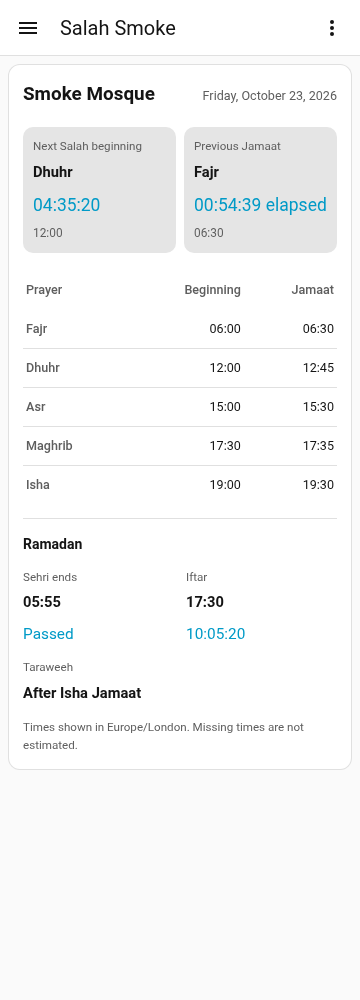

# Dashboard card

The **Salah Timetable** card is bundled with the integration. It uses the mosque's
**Prayer timetable** sensor and requires no separate card download, Card Mod,
template sensors or YAML configuration.

## Historical preview

These historical screenshots predate the 0.6.0 dashboard changes and show synthetic timetable data in the real Home Assistant 2026.10.2
frontend, running integration 0.5.1. They are viewport checks, not physical-device
certification.



[Tablet-width screenshot](images/card-tablet.png)

## Add the card

1. Install/restart the integration, configure a mosque and approve a timetable.
2. Open a dashboard, choose **Edit dashboard → Add card**, and select
   **Salah Timetable**. Reload the browser page if a newly installed card is absent.
3. In the graphical editor, choose that mosque's **Prayer timetable** sensor. Its
   entity ID typically ends in `_prayer_timetable`; HA permits users to rename it.
   Individual beginning/Jamaat sensors do not contain the full card data.
4. Optionally set a title and choose compact/expanded layout, countdown visibility,
   time format, Hijri adjustment and additional details, then save.
   **Upcoming Jamaat** is the default; **Context aware** and **Previous Jamaat** remain available.

Create a separate card for each mosque. The integration creates one device/config
entry per mosque, and each card follows the selected entity's mosque timezone.

## What the card shows

- Mosque name or your optional title, Gregorian date and calculated Hijri date.
- **Next Salah Begins** and **Next Jamaat**, with prominent independent countdowns,
  absolute times and progress between consecutive published events of each kind.
- Optional context/previous Jamaat modes retain elapsed-time behaviour. Progress is
  hidden for previous events or when the preceding published event is unavailable.
- Fajr, Dhuhr, Asr, Maghrib and Isha beginning/Jamaat times. Published Friday Jumu'ah
  congregations appear in the Dhuhr row and retain their event identity.
- When Ramadan is active: Sehri and Iftar countdowns, plus published Taraweeh time
  or **After Isha Jamaat**.

The layout adapts to narrow screens and uses Home Assistant's light/dark theme
variables. Times use the configured mosque timezone, even when the browser is in
another timezone. Countdowns update locally once per second from absolute event
timestamps; they do not write Home Assistant sensor states or call services. At
large text sizes, the prayer table stays inside a labelled, keyboard-focusable
scroll region so its columns remain readable without widening the card.

## Jamaat modes and boundaries

| Mode | Jamaat panel |
| --- | --- |
| Context aware | Previous Jamaat before a prayer begins; upcoming Jamaat after beginning and before its congregation; previous Jamaat with elapsed time from its scheduled instant onward |
| Previous Jamaat | Most recent known congregation at or before the current instant |
| Upcoming Jamaat (default) | Next known congregation strictly after the current instant |

Next Salah beginning is calculated independently in every mode. For example, after
Fajr beginning but before Fajr Jamaat, the card counts down to Fajr Jamaat while
showing Dhuhr as the next Salah beginning. At the exact Jamaat instant it becomes
the previous event with zero elapsed time. A congregation is a single scheduled
event, without an end time.

After Isha, the next Salah uses tomorrow's actual Fajr record. Missing tomorrow data
shows an unavailable result; the integration never repeats today's Fajr. Events are
drawn from yesterday, today and tomorrow, including year/leap-day boundaries. The
browser uses the supplied timeline for local boundary transitions while HA also
refreshes at event boundaries and local midnight.

## Prayer emphasis and layout

The prayer awaiting Jamaat stays highlighted through its final published congregation.
Once that congregation occurs, the next prayer is highlighted. Without a published
Jamaat, the current row remains highlighted until the next known beginning. Completed
rows use secondary text while staying visible. Tomorrow's Fajr never highlights today's
completed Fajr row. A missing beginning cannot be inferred from its congregation.

Beginning and Jamaat use consistent columns. Multiple congregations stack within the
Jamaat cell; actual Jumu’ah events are labelled there while the Dhuhr beginning keeps
its own meaning. Neither labels nor highlighting change source data.

Countdowns sit side by side when the card has enough room and stack on narrow cards
or at enlarged text sizes. Compact layout reduces spacing and number sizes; it does
not hide information. Progress uses elapsed absolute time, including clock changes,
and is hidden when a valid preceding event is unavailable.

## Dates and customization

The Hijri header uses the browser's **Umm al-Qura** calendar to convert the mosque's
Gregorian timetable date. It advances at mosque-local midnight, not at sunset.
The optional −3 to +3 day adjustment changes only the displayed Hijri date. It does
not shift imported records, prayer events, Ramadan confirmation or Ramadan's separate
date adjustment. The date is labelled calculated; unsupported browsers show
**Hijri date unavailable** rather than silently substituting another calendar.

All options are available in the graphical editor and apply independently to each card:

| YAML option | Values and default |
| --- | --- |
| `layout` | `expanded` (default), `compact` |
| `mode` | `upcoming` (default), `context`, `previous` |
| `time_format` | `24h` (default), `12h`; applies to every absolute time |
| `show_salah_countdown` | `true` |
| `show_jamaat_countdown` | `true` |
| `show_hijri_date` | `true` |
| `hijri_adjustment` | Whole days −3 through +3; default `0` |
| `show_ramadan_details` | `true`; controls the entire Ramadan section |
| `show_sehri_countdown` | `true`; hiding retains the published time |
| `show_iftar_countdown` | `true`; hiding retains the published time |
| `show_timezone_note` | `true`; controls timezone/help text |

Hiding either main countdown removes its panel; the remaining panel fills the width.
Hiding both leaves the header and timetable. Connection warnings remain visible even
when help text is hidden. Taraweeh belongs to the Ramadan details section. Countdown
durations always use hours/minutes/seconds, independent of 12/24-hour time format.
Existing explicitly configured Jamaat modes remain unchanged. Cards that omit `mode`
now use the upcoming congregation.

## Ramadan controls

Use the mosque integration's **Configure → Ramadan settings**; the card reflects
these settings automatically.

**Automatic** needs both confirmed Gregorian start/end dates, inclusive, spanning
1–35 days. With no confirmed range it is inactive. **Manual on** explicitly activates
Ramadan until changed and ignores the date window; **Off** disables it. The whole-day
-3 to +3 adjustment shifts the confirmation window only. It never shifts source rows.
Clear both date fields to remove an old confirmation.

During active dates, a matching Ramadan row overrides the same annual date field by
field. Choose an explicit source if multiple Ramadan tables overlap; automatic
selection requires a unique match. An import's dates or printed Hijri dates alone
never confirm Ramadan. Missing override fields retain annual values; missing dates
never borrow another day's row.

A separately published Iftar time takes priority. Otherwise Iftar uses effective
Maghrib beginning if present. Missing published Taraweeh shows **After Isha Jamaat**;
the integration does not create a separate Taraweeh timestamp. Sehri/Iftar countdowns
use active Ramadan dates only. Original imported values remain unchanged.

## Resource troubleshooting

The integration serves versioned assets and automatically registers the card in
storage-mode Lovelace resources. With YAML-managed resources it uses HA's supported
extra-JavaScript registration without editing your YAML. A second manual resource
is normally unnecessary.

If the card remains unavailable after restarting the integration and reloading the
browser, check Home Assistant logs for resource-registration errors. As a fallback,
add this **JavaScript module** resource through **Settings → Dashboards → Resources**
(enable Advanced Mode in your HA profile if the Resources option is hidden):

```text
/salah_timetable/salah-timetable-card.js?v=0.6.0
```

Reload the page after saving. Check for obsolete or duplicate manual resources if an
old card version persists. The integration updates its own registration on upgrades;
manual fallback URLs may need their version changed to the installed version.

If the card reports a missing entity, choose the mosque's Prayer timetable sensor
again. If prayer values are unavailable, check the approved source's date coverage,
field mappings and mosque timezone. An empty mosque has no prayer times until an
import is approved. A connection warning means the card is displaying the last data
received; restore the HA connection before relying on it for changed timetable data.

For reference, the card's optional YAML representation is:

```yaml
type: custom:salah-timetable-card
entity: sensor.example_mosque_prayer_timetable
mode: upcoming
layout: expanded
time_format: 24h
show_hijri_date: true
hijri_adjustment: 0
```

The graphical editor produces this configuration. `mode` accepts `context`,
`previous` or `upcoming`; `title` is optional. The example entity ID must be replaced
with the selected mosque's actual entity ID.

## Validation limits

Backend event/flow tests, Node frontend tests and an isolated headless Chromium
harness cover the implemented behavior. That harness uses stand-ins for HA elements.
A separate disposable HA 2026.10.2 manual installation also verified actual card
loading, real selector/editor interactions, resource upgrades and phone/tablet
viewports. HACS installation, complete manual picker workflows and physical-device
visual checks remain release work. See the [validation record](validation.md) and
[Milestone 6](milestones.md#milestone-6--release-hardening-partially-implemented).
