# Start using Salah Timetable

Follow this guide to install the integration, approve a mosque timetable and add
its dashboard card. For detailed options, see the linked reference guides.

## Install the integration

Home Assistant <!-- docs:homeassistant_min -->2026.10.0<!-- /docs:homeassistant_min --> or later is required.

<!-- docs:excerpt installation -->
Use Home Assistant OS or Home Assistant Container on Linux; these supply the process limits required for PDF extraction. The tested versions are listed in the [compatibility guide](testing.md#compatibility-test-environments).

### HACS catalogue (recommended)

Salah Timetable is officially listed in the [default HACS catalogue](https://github.com/hacs/default/blob/master/integration). On Home Assistant 2026.10, [install and configure HACS](https://www.hacs.xyz/docs/use/) first. On Home Assistant 2026.11 and newer, HACS is built in as [Marketplace](https://www.hacs.xyz/docs/marketplace/).

1. Open **HACS** on Home Assistant 2026.10, or **Settings → Marketplace** on 2026.11 and newer, and search for **Salah Timetable**.
2. Open its catalogue entry, select **Download** in HACS or **Install** in Marketplace, confirm the latest stable version and restart Home Assistant.
3. Open **Settings → Devices & services → Add integration → Salah Timetable**.
4. Enter the mosque name, a stable mosque ID and its IANA timezone (for example, `Europe/London`). Use a different ID to add another mosque.

### HACS custom repository (fallback)

If you cannot find the catalogue entry, add the repository manually in HACS:

1. In HACS, open the top-right **⋮ → Custom repositories** menu.
2. Add `https://github.com/anaschillin/home-assistant-salah-timetable`, select type **Integration** and choose **Add**.
3. Follow steps 2–4 of the HACS catalogue procedure above to download, restart and configure the integration.

In Marketplace, use **Add from link** with the same repository URL and choose **Add**, connecting GitHub if prompted. If it is already listed, use its catalogue entry, then follow steps 2–4 of the HACS catalogue procedure above.

### Manual installation

Download the desired [stable release](https://github.com/anaschillin/home-assistant-salah-timetable/releases), extract it, and copy the complete `custom_components/salah_timetable` directory into Home Assistant's configuration directory as `config/custom_components/salah_timetable/`. The `manifest.json` must be directly inside that directory, with its `frontend/`, `translations/` and other bundled files alongside it. Restart Home Assistant, then follow steps 3–4 of the HACS catalogue procedure above.
<!-- /docs:excerpt installation -->

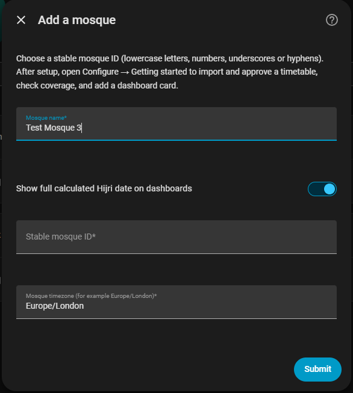

Enter a name, a unique stable ID and the mosque timezone before submitting.

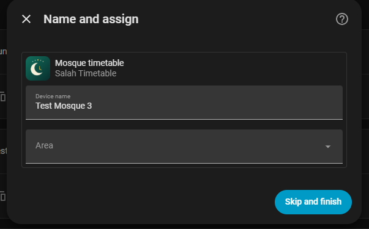

Finish device assignment, then open the mosque’s **Configure** menu.

### Installation fields

| Field | Required / initial value | Meaning |
| --- | --- | --- |
| Mosque name | Required; no default | Display name, 1–100 characters after trimming surrounding spaces. Change it later through **Reconfigure**. |
| Stable mosque ID | Required; no default | Unique storage/entity identity, 1–64 characters: lowercase letters, digits, `_` or `-`, starting with a letter or digit. Input is trimmed and lowercased. Use a different ID for each mosque; it cannot be changed later. |
| Mosque timezone | Required; defaults to Home Assistant's timezone | A valid IANA zone such as `Europe/London`. Published local clock times are interpreted in this zone, including DST validation. |
| Show full calculated Hijri date on dashboards | Optional; enabled initially | Enables the calculated dashboard date; it does not activate Ramadan or alter imported dates/times. Individual cards can also hide the header. |

Setup requires no account, credentials or timetable connection. It creates a mosque;
prayer values become available after you approve a supported import. To add another
mosque, repeat the installation's **Add integration** step with a different ID.

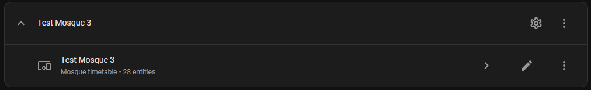

## Import prayer times

1. Under **Devices & services**, open the mosque's **Configure** menu and choose **Getting started and readiness**.
2. Choose the public HTTPS URL, PDF or CSV option. If an import is already pending, choose **Review pending import** instead.
3. Choose the printed Gregorian year and timetable type. Map only fields your mosque published; check any suggested CSV mapping against the file.
4. Review the layout, dates, warnings and prayer values. When replacing data, use **Compare changes before approval** to check additions, removals and changed times.
5. Choose **Approve and save timetable** to activate it, or reject it to retain existing approved data. Ramadan imports also require separate [activation settings](import_review.md#ramadan-settings).

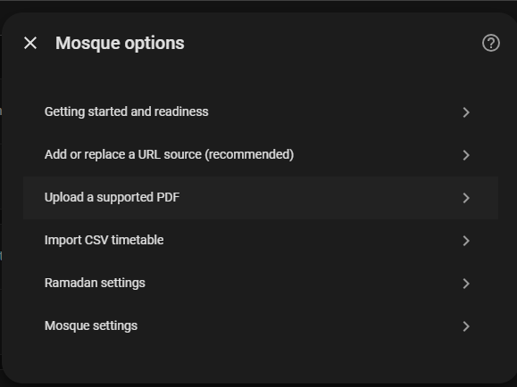

Reopen **Configure → Getting started and readiness** to check the saved mosque
timezone, today's and tomorrow's coverage, and the names and counts of missing
required fields.
The screen links to mosque settings and does not verify the original publication or
approve an import. If the integration is not loaded, check its status before importing.

For an approved annual URL source, **Prepare next year's URL publication**
starts a separate new-year import using a URL you supply or review from a configured template. Check its
[eligibility and review requirements](import_review.md#guided-annual-publication-rollover);
the current year remains available until its own published coverage ends.

PDF imports recognise **only** [documented layouts](import_review.md#supported-pdf-layouts). Scanned pages and unknown layouts are unsupported; CSV may be a suitable alternative. Missing times remain unavailable.

See the [configuration reference](import_review.md#configuration-fields-and-defaults)
for CSV cross-year limits, source management and Ramadan controls. The [entity reference](automations.md#entities-per-mosque)
lists the sensors and calendar created for each mosque.

## Add the dashboard card

1. Choose **Edit dashboard → Add card → Salah Timetable**.
2. Under **Mosques available on this card**, tick the Prayer timetable sensors to display (not individual Fajr or Dhuhr sensors). At least one mosque must remain selected.
3. Use the six-dot drag handle or up/down arrows to reorder selected mosques. **Shown first** identifies the default mosque. Unchecked mosques cannot be reordered.
4. Choose **Compact**, **Standard** or **Detailed** in the graphical editor. To set a custom title, use the [YAML configuration](dashboard.md#dates-and-customization).
5. Expand the relevant settings section to configure dates, countdowns, Ramadan, appearance or timetable tools. On/off features use switches; background choices are in **Appearance → Mosque background**.

Separate cards and dashboards may show different mosques. The duplicate primary-sensor radio selector has been removed.

The Yesterday, Today and Tomorrow controls show approved rows for the selected day.
The calculated Hijri header is for display; it does not activate Ramadan or change
published timestamps. See [Dashboard](dashboard.md) for card options and
[Automations](automations.md) for alerts and speaker playback. The [Prayer reminders wizard](automations.md#guided-prayer-reminders) guides
administrators through mosque selection, prayers, advance minutes and delivery.

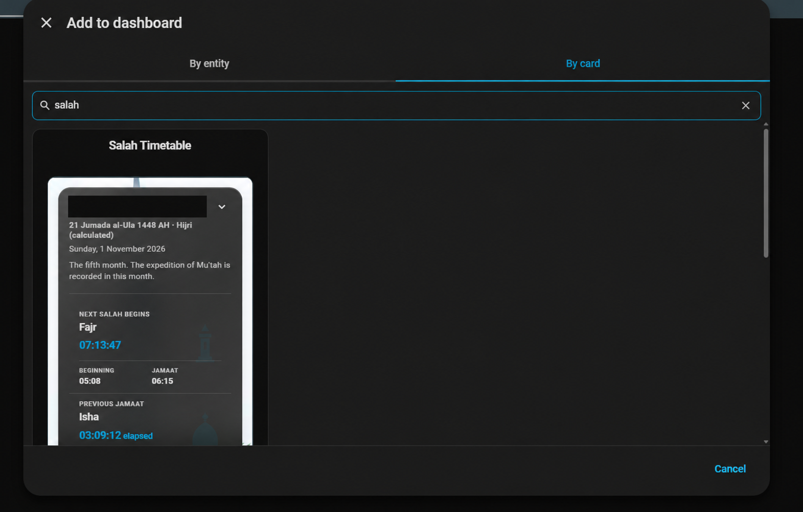

### Card configuration

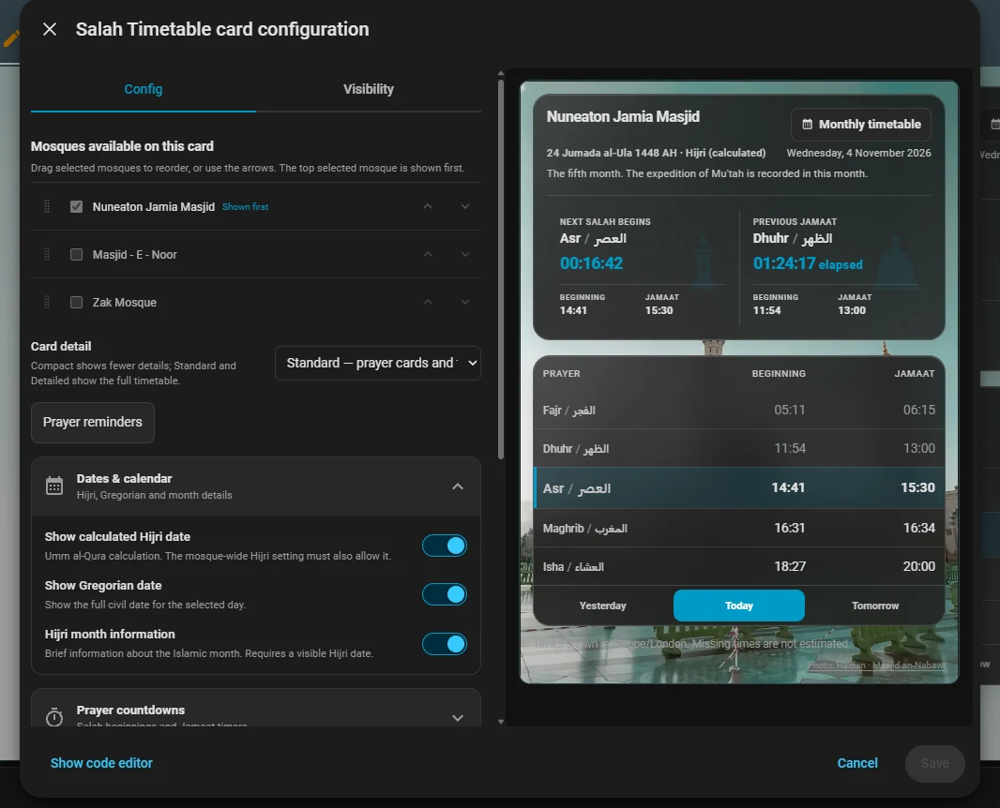

The graphical editor has one ordered mosque checkbox list, a **Card detail**
selector and seven expandable settings groups. The **Shown first** label marks
the default mosque; changes are reflected in the live preview. The new screen
captures show a real configured mosque name rather than anonymised sample data.
They reflect the current published card UI; older installations can differ.

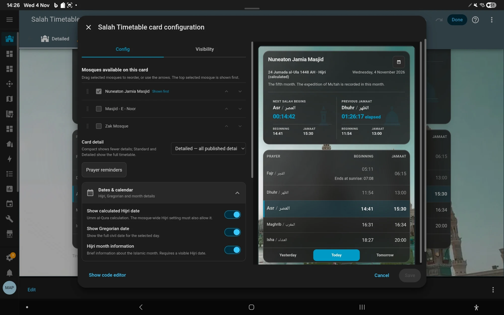

The same card editor also works on a tablet. On narrow screens, scroll within
the editor to reach lower settings. Planned Islamic-history switches remain disabled.

For a dedicated display, enable **Kiosk / wall display mode** in the card editor.
The [approved v3.0 kiosk screenshot](screenshots/showcase/desktop/kiosk-v3.webp)
shows the live clock, two countdowns, five daily prayer tiles, and the icon-only
fullscreen toggle in the summary's upper-right corner. Tap the icon to enter
fullscreen and tap it again (or press Escape) to return to the previous view.
See [Wall and tablet display](dashboard.md#wall-and-tablet-display) for details.

### Browse yesterday and the monthly timetable

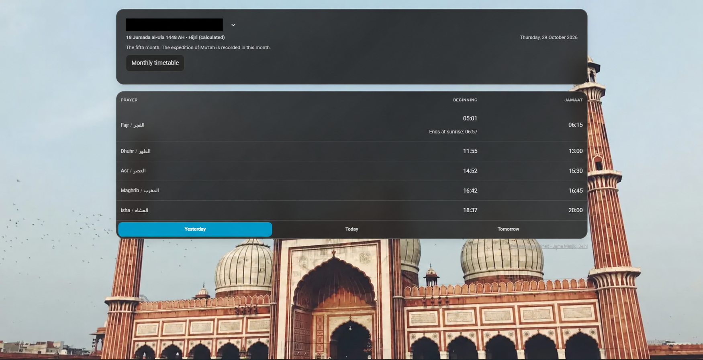

Yesterday and Tomorrow omit live countdowns and current-prayer highlighting.

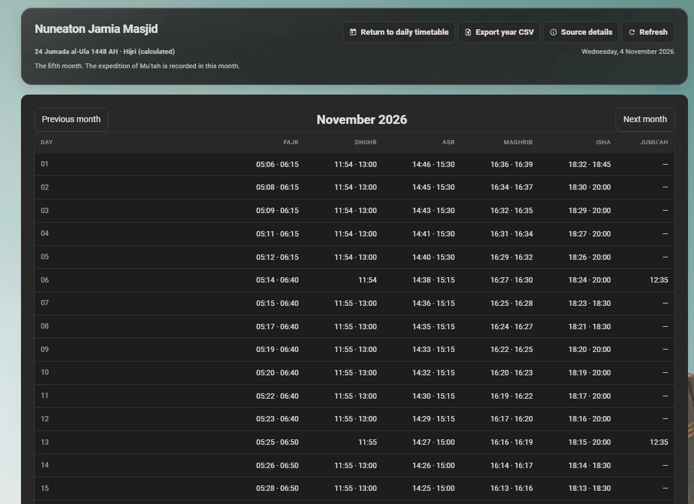

Enable **Monthly timetable, CSV export and source details** under **Timetable & information** to open the Gregorian month browser. In **Compact**, open **More**; in **Standard** and **Detailed**, use the labelled calendar action right-aligned with the mosque name, above the Gregorian date (icon-only on narrow cards). The CSV, source and refresh actions appear in that same location when browsing a month.

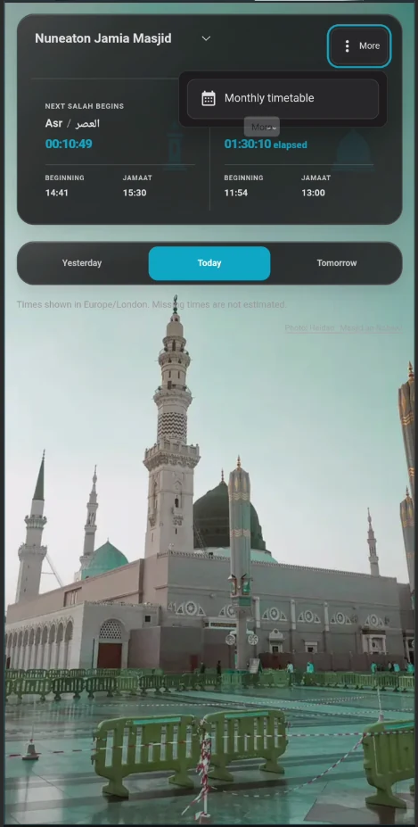

In Compact mode, **More** opens the monthly action. While viewing a month,
the same menu offers **Return to daily timetable**, **Export year CSV**,
**Source details** and **Refresh**. Scroll to see the rest of the month; only
approved dates and fields appear. The export is for the current displayed
Gregorian year, not the mosque's source PDF. See [all device and mode
screenshots](dashboard.md#device-screenshots).

These are example interface captures, not a substitute for checking your mosque's approved publication. The background photograph is decorative and does not identify the configured mosque.

## Check prayer completeness

Under **Configure → Mosque settings**, select the fields your mosque consistently
publishes. The default is the five daily Salah beginnings. The **Prayer completeness**
diagnostic identifies missing fields, while **Timetable coverage** reports date
coverage. To receive alerts, import the optional [Prayer completeness alert blueprint](automations.md#prayer-completeness)
and select your mosque's diagnostic sensor and your own actions.

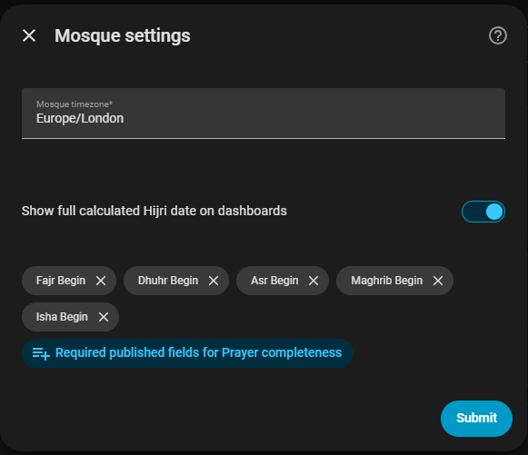

## Reconfigure or remove a mosque

Under **Settings → Devices & services → Salah Timetable**, open the menu for
the specific mosque:

- **Reconfigure** changes the mosque display name and IANA timezone while
  preserving the stable mosque ID, approved imported timetables, and entity
  identities. Check the prayer timestamps after changing timezone: the
  published local clock times will be interpreted in the newly selected zone.
- **Configure → Mosque settings** also allows changing the timezone and
  toggling the optional Hijri date display. The latest timezone setting is
  retained consistently across both flows.
- **Delete** removes that mosque's Home Assistant configuration entry and its
  persisted imported timetables. Other configured mosques are not affected.

The stable mosque ID is intentionally immutable to keep the related entity IDs,
automations and timetable storage consistent. If a different mosque ID is
required, create a separate mosque configuration and reimport its timetable.

**Before deletion**, retain the original PDF/CSV or URL publication details you
may need for a new installation, and review any dashboards and automations
using that mosque's sensors. Removing a dashboard card alone does not delete
the mosque data. To uninstall the entire integration, delete each configured
mosque first, then remove Salah Timetable from HACS (or manually remove its
`custom_components/salah_timetable` files) and restart Home Assistant.

## Common problems

| Symptom | Check |
| --- | --- |
| Salah Timetable not found in Add integration | Confirm HACS downloaded the integration to `custom_components/salah_timetable`, then restart HA |
| PDF not recognised | Compare with [supported layouts](import_review.md#supported-pdf-layouts). Scanned/encrypted/unknown layouts fail closed; convert a legitimate published timetable to CSV when appropriate |
| URL download fails | Use a publicly accessible HTTPS URL on port 443, without credentials or private-network destinations. HTTPS redirects, types and sizes are strictly checked |
| No prayer times or countdown | Confirm import approval, correct mosque timezone and date coverage. Missing tomorrow means the next Fajr may be unavailable after Isha |
| Card missing from dashboard picker | Confirm the integration is loaded; reload the HA frontend, inspect the bundled `/salah_timetable/salah-timetable-card.js` resource, and follow [resource troubleshooting](dashboard.md#resource-troubleshooting) |
| Card shows another mosque | Reorder **Mosques available on this card** so the intended default is **Shown first**, or uncheck other mosques |
| Ramadan data not shown | Verify explicit Ramadan start/end, active mode, selected source and source date coverage; Hijri display alone is not activation |
| Changed URL source not applied | Open **Configure → Review pending import**; remote updates are staged, never automatically approved |
| Prayer automation doesn't fire | Ensure the selected timestamp entity is available *before* its event/offset, and use rolling **Next Jamaat**/**Next Sehri** for early reminders |

## When asking for support

Include the Home Assistant version, integration version, whether you installed via HACS/manual method, the selected mosque timezone, a screenshot of the problem using synthetic or redacted data, and the expected versus actual date/time. The [support policy](#support-and-compatibility-policy) explains safe diagnostic sharing. Do **not** post private source URLs, security tokens, full config backups or original non-redistributable PDFs.

[Back to main README](../README.md)

## Support and compatibility policy

<!-- docs:excerpt support-summary -->
Salah Timetable is a community-maintained, MIT-licensed integration without guaranteed response times or a paid support service. Compatibility is limited to the [pinned Home Assistant environments](testing.md#compatibility-test-environments) and [documented timetable layouts](import_review.md#supported-pdf-layouts).
<!-- /docs:excerpt support-summary -->

The supported Home Assistant versions are determined by the pinned compatibility test projects, not an open-ended promise of compatibility. See [testing environments](testing.md#compatibility-test-environments) for exact versions and [release validation](releasing.md#validation-and-acceptance-scope) for the scope of automated versus manual testing. Home Assistant OS/Container on Linux supplies the process resource limits used to isolate PDF extraction; other installation methods are outside the recorded acceptance matrix.

When reporting a bug, follow [When asking for support](#when-asking-for-support) and provide redacted diagnostics. For a new PDF layout, provide a public publication URL and clarify whether it can legally be redistributed as a test fixture. Compatibility is added only after inspection and tests; resemblance to an existing layout is not sufficient.

Report security issues privately following [SECURITY.md](../SECURITY.md).
