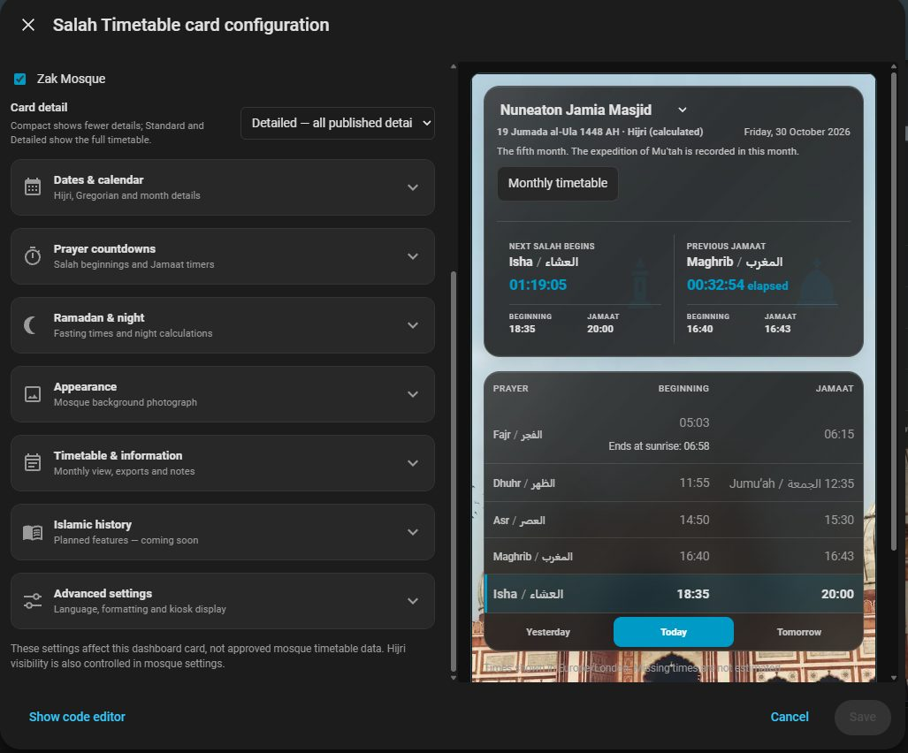
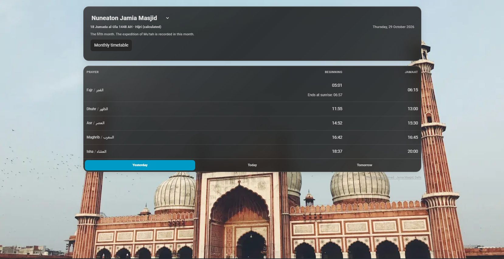
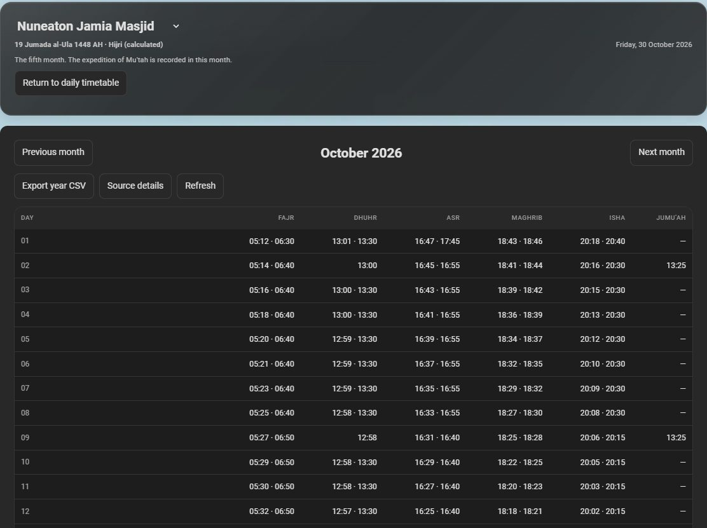

# Start using Salah Timetable

This quickstart is for Home Assistant users installing the integration for the first time. For detailed developer internals see [architecture](architecture.md), [test guide](testing.md) and [release acceptance](releasing.md).

## Install the integration

Home Assistant <!-- docs:homeassistant_min -->2026.10.0<!-- /docs:homeassistant_min --> or later is required.

<!-- docs:excerpt installation -->
Use Home Assistant OS or Home Assistant Container on Linux; these supply the process limits required for PDF extraction. The tested versions are listed in the [compatibility guide](testing.md#compatibility-test-environments). For the HACS route, [install and configure HACS](https://www.hacs.xyz/docs/use/) first.

1. In HACS, open **Custom repositories**, add `https://github.com/anaschillin/home-assistant-salah-timetable` and select **Integration**.
2. Download **Salah Timetable** and restart Home Assistant.
3. Open **Settings → Devices & services → Add integration → Salah Timetable**.
4. Enter the mosque name, a stable mosque ID and its IANA timezone (for example, `Europe/London`). Use a different ID to add another mosque.

This is a **HACS custom repository**, not a listing in the default HACS catalogue. For manual installation, download the desired [stable release](https://github.com/anaschillin/home-assistant-salah-timetable/releases), extract it, and copy the complete `custom_components/salah_timetable` directory into Home Assistant's configuration directory as `config/custom_components/salah_timetable/`. The `manifest.json` must be directly inside that directory, with its `frontend/`, `translations/` and other bundled files alongside it. Restart Home Assistant, then follow steps 3–4 above.
<!-- /docs:excerpt installation -->

### Installation fields

| Field | Required / initial value | Meaning |
| --- | --- | --- |
| Mosque name | Required; no default | Display name, 1–100 characters after trimming surrounding spaces. Change it later through **Reconfigure**. |
| Stable mosque ID | Required; no default | Unique storage/entity identity, 1–64 characters: lowercase letters, digits, `_` or `-`, starting with a letter or digit. Input is trimmed and lowercased. Use a different ID for each mosque; it cannot be changed later. |
| Mosque timezone | Required; defaults to Home Assistant's timezone | A valid IANA zone such as `Europe/London`. Published local clock times are interpreted in this zone, including DST validation. |
| Show full calculated Hijri date on dashboards | Optional; enabled initially | Enables the calculated dashboard date; it does not activate Ramadan or alter imported dates/times. Individual cards can also hide the header. |

Setup requires no account, credentials or timetable connection. It creates a mosque
configuration; prayer values become available after a supported import is approved.

## Import prayer times

1. Under **Devices & services**, open the mosque's **Configure** menu.
2. Choose **Add or replace a URL source** for a public HTTPS PDF/CSV, or use a manual PDF/CSV upload.
3. Select the printed Gregorian year and source type: **Annual**, **Monthly** or **Ramadan** for PDF/URL imports; **Annual** or **Ramadan** for CSV uploads. Map only columns that the mosque actually published.
4. Review the detected layout, dates, warnings and prayer values. Use **Compare changes before approval** when replacing approved data.
5. Choose **Approve and save timetable** to activate it, or reject it to retain existing approved data. If importing Ramadan times, confirm the Ramadan date window separately in mosque settings.

For an approved annual URL source, **Prepare next year's URL publication**
starts a separate new-year import using a URL you supply. Check its
[eligibility and review requirements](import_review.md#guided-annual-publication-rollover);
the current year remains available until its own published coverage ends.

PDF imports recognise **only** [documented layouts](import_review.md#supported-pdf-layouts). Scanned pages and unknown layouts are unsupported; CSV may be a suitable alternative. Never invent missing times.

See the [configuration reference](import_review.md#configuration-fields-and-defaults)
for import, source-management and Ramadan controls, and the [entity reference](automations.md#entities-per-mosque)
for the sensors and calendar created for each mosque.

## Add the dashboard card

1. Choose **Edit dashboard → Add card → Salah Timetable**.
2. Select the mosque's **Prayer timetable** sensor (not an individual Fajr or Dhuhr sensor).
3. Choose **Compact**, **Standard** or **Detailed** in the graphical editor.
4. Expand the relevant settings section to configure dates, countdowns, Ramadan, appearance or timetable tools. On/off features use switches; background choices are in **Appearance → Mosque background**.
5. If more than one mosque is configured, use **Mosques available on this card** to select which mosques appear. Separate cards and dashboards may show different mosques.

The Yesterday, Today and Tomorrow controls display approved source rows for the selected day. The calculated Hijri header is for display only; it does not activate Ramadan or change published timestamps.

For appearance, mobile layouts and language options see [Dashboard](dashboard.md). For prayer alerts and speaker playback see [Automations](automations.md).

### Card configuration

The graphical editor groups settings for dates, countdowns, Ramadan, appearance, timetable information, Islamic history (planned options are disabled), and advanced preferences. Switches control individual features; the mosque checkboxes choose which configured mosques appear in this card.

### Browse yesterday and the monthly timetable

Use **Yesterday / Today / Tomorrow** in the card footer to browse each day's approved timetable. Yesterday and Tomorrow intentionally omit live countdowns and current-prayer highlighting.

Enable **Monthly timetable, CSV export and source details** under **Timetable & information** to open the Gregorian month browser. Scroll to see the rest of the month; only approved dates and fields appear. The export is for the current displayed Gregorian year, not the mosque's source PDF.

These are example interface captures, not a substitute for checking your mosque's approved publication. The background photograph is decorative and does not identify the configured mosque.

## Check prayer completeness

**Configure → Mosque settings** allows selecting the published fields required
by the Prayer completeness diagnostic. The default is the five daily Salah
beginning times. Add Jamaat or Sunrise only when your mosque publishes those
consistently. The **Prayer completeness** diagnostic identifies today's
missing fields, tomorrow's gaps and the first incomplete future date, without
altering the existing **Timetable coverage** sensor.

## Reconfigure or remove a mosque

Under **Settings → Devices & services → Salah Timetable**, open the menu for
the specific mosque:

- **Reconfigure** changes the mosque display name and IANA timezone while
  preserving the stable mosque ID, approved imported timetables, and entity
  identities. Check the prayer timestamps after changing timezone: the
  published local clock times will be interpreted in the newly selected zone.
- **Configure → Mosque settings** also allows changing the timezone and
  toggling the optional Hijri date display. The latest timezone setting is
  retained consistently across both flows.
- **Delete** removes that mosque's Home Assistant configuration entry and its
  persisted imported timetables. Other configured mosques are not affected.

The stable mosque ID is intentionally immutable to keep the related entity IDs,
automations and timetable storage consistent. If a different mosque ID is
required, create a separate mosque configuration and reimport its timetable.

**Before deletion**, retain the original PDF/CSV or URL publication details you
may need for a new installation, and review any dashboards and automations
using that mosque's sensors. Removing a dashboard card alone does not delete
the mosque data. To uninstall the entire integration, delete each configured
mosque first, then remove Salah Timetable from HACS (or manually remove its
`custom_components/salah_timetable` files) and restart Home Assistant.

## Common problems

| Symptom | Check |
| --- | --- |
| Salah Timetable not found in Add integration | Confirm HACS downloaded the integration to `custom_components/salah_timetable`, then restart HA |
| PDF not recognised | Compare with [supported layouts](import_review.md#supported-pdf-layouts). Scanned/encrypted/unknown layouts fail closed; convert a legitimate published timetable to CSV when appropriate |
| URL download fails | Use a publicly accessible HTTPS URL on port 443, without credentials or private-network destinations. HTTPS redirects, types and sizes are strictly checked |
| No prayer times or countdown | Confirm import approval, correct mosque timezone and date coverage. Missing tomorrow means the next Fajr may be unavailable after Isha |
| Card missing from dashboard picker | Confirm the integration is loaded; reload the HA frontend, inspect the bundled `/salah_timetable/salah-timetable-card.js` resource, and follow [resource troubleshooting](dashboard.md#resource-troubleshooting) |
| Card shows another mosque | Set the correct **Prayer timetable** sensor and optionally restrict the per-card mosque list |
| Ramadan data not shown | Verify explicit Ramadan start/end, active mode, selected source and source date coverage; Hijri display alone is not activation |
| Changed URL source not applied | Open **Configure → Review pending import**; remote updates are staged, never automatically approved |
| Prayer automation doesn't fire | Ensure the selected timestamp entity is available *before* its event/offset, and use rolling **Next Jamaat**/**Next Sehri** for early reminders |

## When asking for support

Include the Home Assistant version, integration version, whether you installed via HACS/manual method, the selected mosque timezone, a screenshot of the problem using synthetic or redacted data, and the expected versus actual date/time. The [support policy](#support-and-compatibility-policy) explains safe diagnostic sharing. Do **not** post private source URLs, security tokens, full config backups or original non-redistributable PDFs.

[Back to main README](../README.md)

## Support and compatibility policy

<!-- docs:excerpt support-summary -->
Salah Timetable is a community-maintained, MIT-licensed integration without guaranteed response times or a paid support service. Compatibility is limited to the [pinned Home Assistant environments](testing.md#compatibility-test-environments) and [documented timetable layouts](import_review.md#supported-pdf-layouts).
<!-- /docs:excerpt support-summary -->

The supported Home Assistant versions are determined by the pinned compatibility test projects, not an open-ended promise of compatibility. See [testing environments](testing.md#compatibility-test-environments) for exact versions and [release validation](releasing.md#validation-and-acceptance-scope) for the scope of automated versus manual testing. Home Assistant OS/Container on Linux supplies the process resource limits used to isolate PDF extraction; other installation methods are outside the recorded acceptance matrix.

Only the specific inspected PDF structures in [Supported PDF layouts](import_review.md#supported-pdf-layouts) are recognised; scanned and other unknown layouts are unsupported. CSV may be used for unsupported publication layouts. Missing values stay unavailable, and the Hijri date display does not activate Ramadan or modify published Salah times. See [dashboard](dashboard.md) for Fajr sunrise/end, Friday notes and Hijri options.

When reporting a bug, follow [When asking for support](#when-asking-for-support) and provide redacted diagnostics. For a new PDF layout, provide a public publication URL and clarify whether it can legally be redistributed as a test fixture. Compatibility is added only after inspection and tests; resemblance to an existing layout is not sufficient.

Report security issues privately following [SECURITY.md](../SECURITY.md).
